# AquaPort - Sistema de Drones Acuáticos de la ECI

Refuerzo de temáticas de desarrollo y arquitectura de software (DOSW). El proyecto implementa un sistema para la gestión, asignación y monitoreo de drones acuáticos en el campus de la Escuela Colombiana de Ingeniería, estructurado en tres niveles de evolución.

## Nivel 1: Piplup (MVP)

En esta primera etapa se construye la base funcional del sistema considerando una flota reducida de drones, asignación manual por parte del operador y zonas hídricas fijas.

### Reto 01: Streams y Lambdas

Se implementó el componente de consulta de flota mediante la API de Streams de Java 21, evitando estructuras iterativas tradicionales y variables de estado mutables.

Aspectos implementados:
* Definición del modelo DroneAcuatico como record inmutable para representar la información de cada unidad.
* Consulta de drones disponibles con batería mínima del 35%, ordenados de forma descendente por nivel de carga usando filter y sorted.
* Transformación de la colección para extraer únicamente los identificadores de los drones disponibles mediante map.
* Evaluación de existencia de unidades operativas aptas mediante anyMatch.
* Conteo de drones disponibles en la flota a través de count.
* Búsqueda del drone con mayor nivel de batería mediante max y Optional.
* Ejecución demostrativa en método main y validación automatizada mediante pruebas unitarias en JUnit 5.

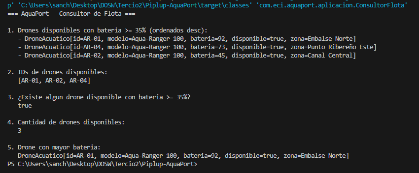

### Reto 02: GitHub y GitFlow

Se configuró el flujo de trabajo colaborativo y control de versiones bajo el modelo GitFlow, asegurando trazabilidad y aislamiento de cambios.

Aspectos implementados:
* Configuración de archivo .gitignore excluyendo artefactos de compilación, carpetas de IDEs y dependencias locales.
* Estructura de ramas principales con rama main para versiones estables y rama develop para integración.
* Creación de la rama feature/streams-consultor-flota para el desarrollo del primer reto.
* Registro de commits atómicos con mensajes en presente y en español describiendo el alcance exacto de cada cambio.
* Integración de la funcionalidad en develop mediante Pull Request revisado y fusionado en GitHub.

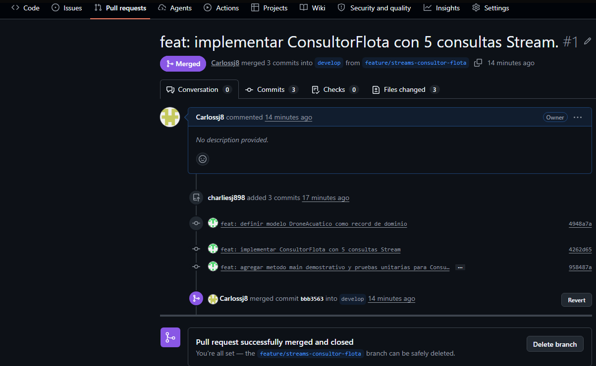

### Reto 03: Patrones de Diseño - Builder

Se aplicó el patrón creacional Builder para la construcción controlada de instancias de la clase Mision, garantizando la integridad de los datos antes de permitir la existencia del objeto.

Aspectos implementados:
* Creación de los enums de dominio TipoCarga y EstadoMision.
* Ocultamiento del constructor de Mision haciéndolo privado, restringiendo la instanciación únicamente al Builder interno.
* Validación estricta en el método build para impedir identificadores, puntos de partida o de llegada nulos o en blanco.
* Regla de negocio que verifica que el drone asignado se encuentre en estado disponible antes de crear la misión.
* Asignación de estado por defecto PENDIENTE cuando no se suministra uno explícito.
* Pruebas unitarias en JUnit 5 que comprueban tanto la construcción exitosa como el lanzamiento de IllegalStateException en cada caso inválido.

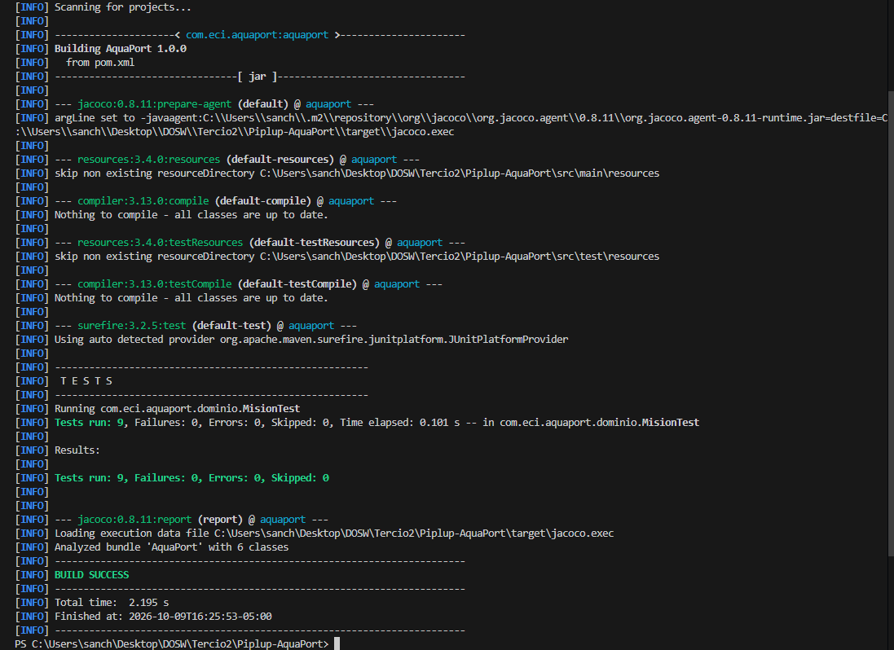

### Reto 04: Principios SOLID (SRP y DIP)

Se rediseñó el núcleo del sistema aplicando el Principio de Responsabilidad Única (SRP) y el Principio de Inversión de Dependencias (DIP) para eliminar el acoplamiento y la acumulación de responsabilidades.

Aspectos implementados:
* Segregación de responsabilidades mediante clases especializadas: RegistradorMisiones coordina el flujo, ValidadorMision encapsula las reglas de negocio, y NotificadorOperador gestiona la comunicación con el usuario.
* Definición de la interfaz RepositorioMisiones en la capa de dominio, aislando la lógica de negocio de los detalles de almacenamiento.
* Implementación en memoria RepositorioMisionesMemoria ubicada en infraestructura.
* Inyección de dependencias por constructor en RegistradorMisiones, permitiendo desacoplamiento total y facilitando el uso de dobles de prueba.
* Pruebas unitarias que verifican validaciones, persistencia, manejo de identificadores duplicados y emisión de notificaciones.

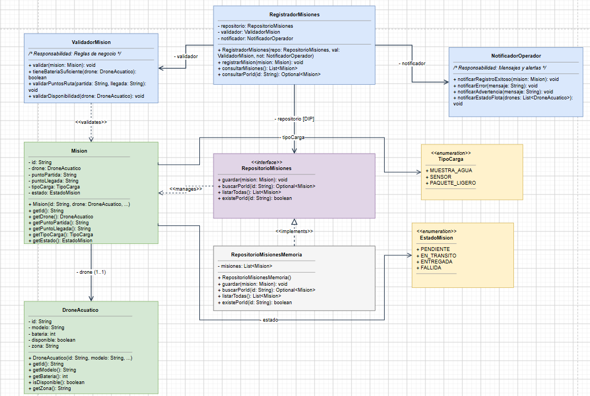

### Reto 05: Diagrama de Contexto C4 (Nivel 1)

Se elaboró el diagrama de contexto C4 correspondiente al nivel 1 para delimitar las fronteras del sistema AquaPort MVP, identificando a los usuarios externos y los flujos de información sin exponer detalles internos de implementación.

Aspectos modelados:
* Sistema central: AquaPort MVP como sistema autónomo de supervisión y gestión de drones acuáticos en el campus de la Escuela Colombiana de Ingeniería.
* Actor Operador Hídrico: Encargado de registrar misiones, consultar la disponibilidad de drones y asignar unidades de forma manual.
* Actor Solicitante: Investigador o miembro del campus que genera requerimientos de transporte de muestras de agua y sensores.
* Actor Administrador ECI: Rol directivo que consulta métricas, reportes de desempeño y estado consolidado de la flota.
* Delimitación del MVP: Ausencia de integraciones con sistemas externos en esta primera fase.
* Relaciones etiquetadas: Definición explícita de los datos y solicitudes que viajan entre cada actor y el sistema central.

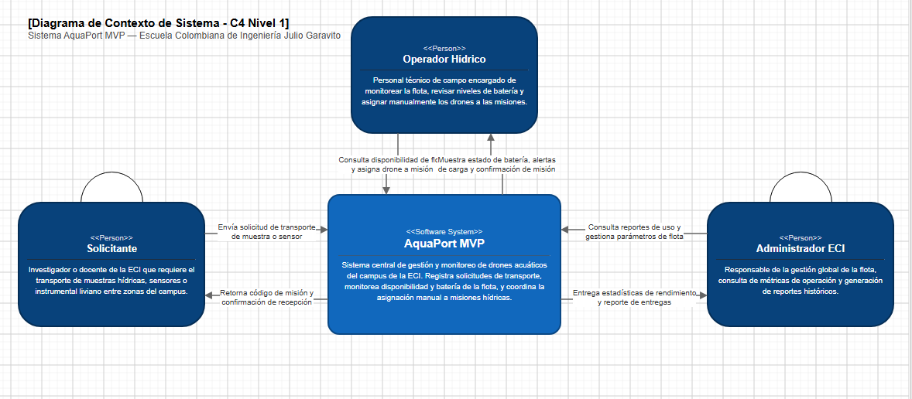

### Reto 06: Requisitos Funcionales, No Funcionales y MoSCoW

Se definieron los requisitos nucleares para AquaPort MVP especificando el actor, la acción y el resultado observable para los funcionales, y métricas cuantitativas para los no funcionales.

#### Requisitos Funcionales (RF)
* RF-01 (Consultar disponibilidad de flota): El Operador Hídrico consulta la flota de drones para visualizar en pantalla el identificador, zona actual y nivel de batería de las unidades disponibles con carga mayor o igual al 35%.
* RF-02 (Registrar y asignar misión de transporte): El Operador Hídrico ingresa los puntos de origen y destino, tipo de carga y asigna manualmente un drone disponible, obteniendo como resultado un identificador único de misión y el registro persistido.
* RF-03 (Consultar estado de misión por identificador): El Solicitante introduce el identificador de su misión para conocer en tiempo real el estado de entrega y el drone responsable asignado.

#### Requisitos No Funcionales (RNF)
* RNF-01 (Tiempo de respuesta de consulta): La consulta de drones disponibles y ordenados por nivel de batería debe ejecutarse en menos de 200 milisegundos para una flota de hasta 10 drones, validado mediante JUnit 5 assertTimeout.
* RNF-02 (Integridad de datos y validación temprana): El sistema debe impedir el 100% de los intentos de registro que contengan campos nulos, puntos de ruta inválidos o drones con batería inferior al 35%, lanzando excepciones de negocio de forma inmediata.
* RNF-03 (Mantenibilidad y cobertura de pruebas): La capa de dominio y validación de misiones debe mantener una cobertura de líneas de código superior o igual al 80%, medida y auditada mediante JaCoCo en la fase de test.

#### Priorización MoSCoW

| Requisito | Tipo | Prioridad MoSCoW | Justificación |
| :--- | :--- | :--- | :--- |
| RF-01 | Funcional | Must Have | Indispensable para que el operador conozca las unidades operativas antes de autorizar cualquier despacho. |
| RF-02 | Funcional | Must Have | Constituye la funcionalidad nuclear de negocio del MVP para posibilitar el transporte de muestras en el campus. |
| RNF-02 | No Funcional | Must Have | Crítico para evitar que se despachen drones descargados o se almacenen registros inconsistentes en el sistema. |
| RF-03 | Funcional | Should Have | Importante para la trazabilidad y consulta por parte de los solicitantes, aunque no detiene la operación física de los drones. |
| RNF-01 | No Funcional | Should Have | Relevante para asegurar una experiencia de usuario ágil durante la consulta manual de la flota en el panel. |
| RNF-03 | No Funcional | Could Have | Conveniente para asegurar la calidad técnica del código base previo a su escalamiento hacia los niveles autónomos. |

### Reto 07: Plantilla DOSW (Especificación de Requerimiento)

Se documentó detalladamente la especificación formal del requerimiento funcional AP-01 utilizando el estándar de la plantilla institucional DOSW, alojada en el repositorio en `docs/word/detalleRequerimientoPiplup`.

Aspectos documentados en la plantilla:
* Código y nombre: AP-01 Registrar misión de transporte de muestra.
* Actor principal: Operador Hídrico.
* Precondición: Existencia en el sistema de al menos un drone acuático disponible con nivel de batería mayor o igual al 35%.
* Estructura de datos de entrada: Tipos de datos reales de dominio para drone asignado (DroneAcuatico), puntoPartida (String), puntoLlegada (String) y tipoCarga (Enum: MUESTRA_AGUA, SENSOR, PAQUETE_LIGERO), evitando elementos genéricos de interfaz gráfica.
* Datos de salida: Identificador alfanumérico generado para la misión y confirmación de persistencia.
* Flujo básico de eventos: Secuencia ordenada de 5 pasos desde la selección de parámetros, validación de disponibilidad, verificación de zonas hídricas hasta la confirmación al operador.
* Flujos alternos: Manejo de escenarios excepcionales para batería crítica del drone (<35%), zonas fuera de cobertura y coincidencia de origen y destino.
* Reglas de negocio: Exclusividad de misión activa por drone y validación obligatoria del umbral mínimo de carga.

### Reto 08: Manual de Identidad y UX/UI

Se estableció el manual de identidad visual y el diseño del panel de monitoreo de flota acuática para el operador, asegurando coherencia visual y cumplimiento de principios de usabilidad antes de la fase de implementación de interfaz.

Aspectos definidos en la identidad:
* Paleta de colores técnica y ambiental inspirada en entornos hídricos, definiendo tonos primarios y fondos oscuros adecuados para paneles de control continuo.
* Código cromático semántico de estados: verde para unidades disponibles, azul para drones en misión, ámbar para recarga, gris para mantenimiento y rojo para fallos.
* Tipografía principal sans-serif de alta legibilidad para interfaces de monitoreo y tipografía monoespaciada para identificadores de drones y códigos de misión.
* Tono de voz técnico, conciso y contextualizado a la gestión hídrica del campus.

#### Evidencias del Manual de Identidad

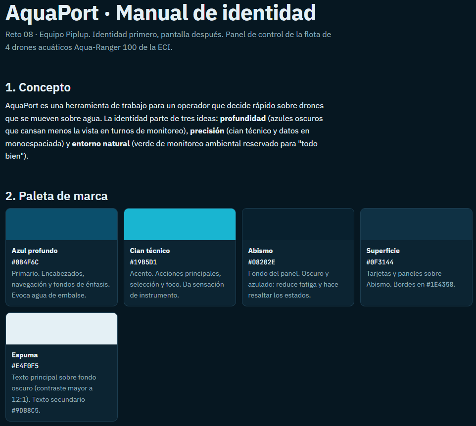

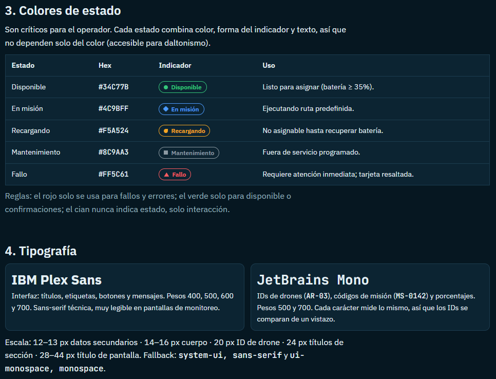

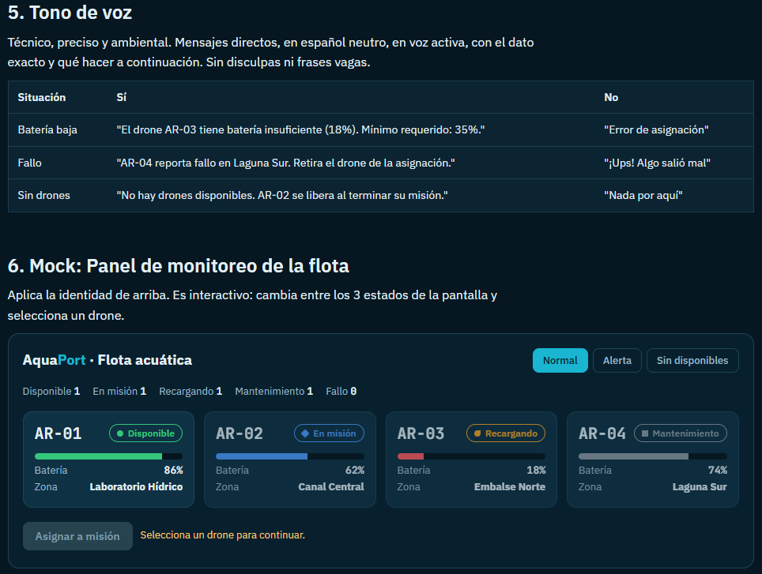

#### Evidencias del Mockup de Panel de Flota

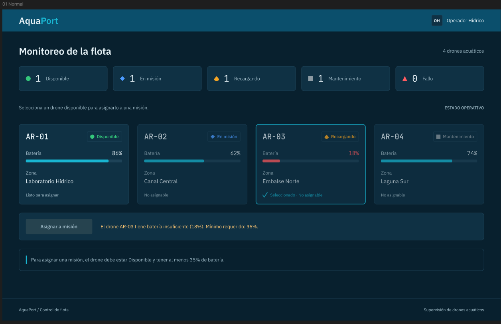

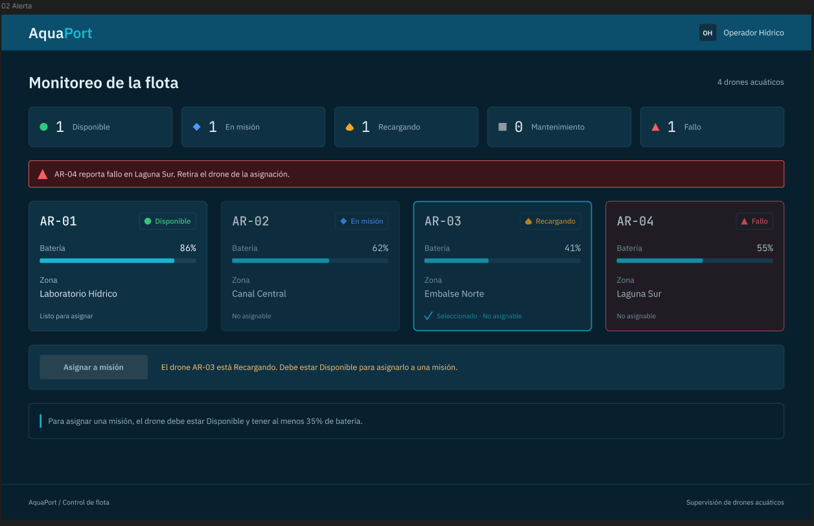

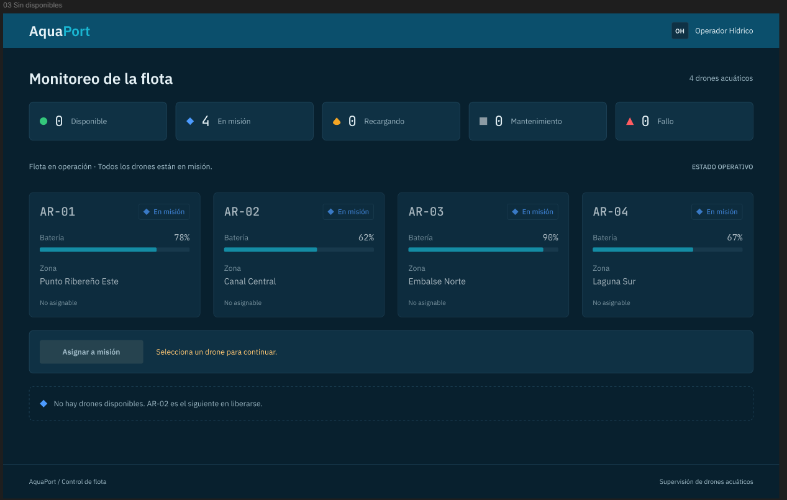

#### Verificación de Heurísticas de Nielsen

El diseño del panel de monitoreo fue evaluado frente a las heurísticas de usabilidad de Jakob Nielsen, cumpliendo 6 de los 10 principios fundamentales:

| Heurística | Cómo la cumple el mock |
| :--- | :--- |
| #1 Visibilidad del estado | Cada tarjeta muestra estado (color, forma y texto), batería y zona sin hacer clic. El resumen superior cuenta los drones por estado. |
| #2 Relación con el mundo real | Usa el lenguaje del operador: nombres reales de zonas (Embalse Norte, Canal Central...) y estados como "En misión" o "Recargando". |
| #4 Consistencia | Los mismos 5 colores, formas y textos de estado se usan en el manual y en el panel. Los IDs siempre van en monoespaciada con formato AR-XX. |
| #5 Prevención de errores | Los drones con batería menor a 35% o no disponibles se atenúan y el botón "Asignar a misión" queda deshabilitado antes de intentar la acción. |
| #8 Diseño minimalista | Cada tarjeta muestra solo ID, estado, batería y zona: lo necesario para decidir. |
| #9 Mensajes de error claros | El motivo del bloqueo aparece junto al botón con dato y umbral ("batería insuficiente (18%). Mínimo requerido: 35%"). El fallo muestra un banner con el drone y la zona. |

### Reto 09: Agilismo y Gestión en Jira

Se estructuró la gestión ágil del desarrollo del sistema AquaPort MVP en Jira, estableciendo la jerarquía de trabajo orientada a valor mediante épica, feature, historias de usuario estructuradas y subtareas técnicas.

Aspectos configurados en el tablero:
* Feature contenedora: AP-5 Gestión de flota acuática.
* Historias de usuario del MVP:
  * AP-2: HU01 - Ver estado y disponibilidad de la flota de drones.
  * AP-3: HU02 - Asignar drone acuático a una misión.
  * AP-4: HU03 - Cancelar misión hídrica pendiente.
* Formulación estándar de HU: Redacción en formato "Como [rol], quiero [funcionalidad], para [beneficio esperado]".
* Criterios de aceptación en formato BDD (Dado/Cuando/Entonces): Definición de escenarios de éxito para asignación válida (batería >= 35% y estado disponible) y escenarios de fallo para restricciones de carga o drones no aptos.
* Descomposición técnica en subtareas para la asignación de drones:
  * AP-6: Implementación de servicio de asignación con validaciones de negocio.
  * AP-7: Construcción del componente de interfaz gráfica para selección y visualización de elegibilidad.
  * AP-8: Pruebas automatizadas unitarias y de integración sobre las condiciones de rechazo por umbral de batería.

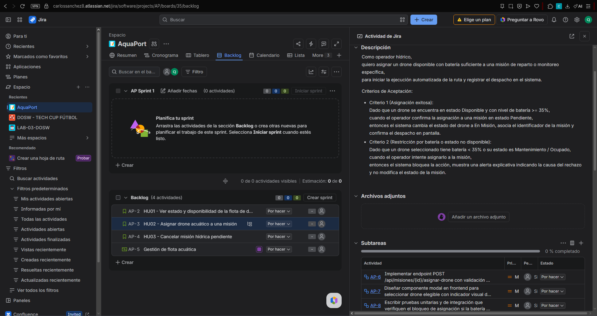

### Reto 10: Diagramas de Casos de Uso (UML)

Se modeló el comportamiento funcional del sistema AquaPort MVP centrado en el requerimiento nuclear AP-01, representando los límites del sistema, actores involucrados y las relaciones de dependencia mediante casos de uso.

Aspectos modelados:
* Límite del sistema: AquaPort MVP como contenedor de las funcionalidades operativas.
* Actores:
  * Operador Hídrico: Actor principal que interactúa con la gestión de flota y registro de misiones.
  * Solicitante: Consulta el avance y estado de entrega de sus muestras.
  * Administrador ECI: Consulta estadísticas generales y reportes de desempeño de la flota.
* Casos de uso principales: Registrar misión de transporte, Consultar disponibilidad de flota, Cancelar misión pendiente, Consultar estado de misión y Generar reportes de operación.
* Relación «include» (Obligatoria): Registrar misión incluye indispensablemente Validar disponibilidad y batería del drone, garantizando que ninguna misión se genere sin verificación previa.
* Relación «extend» (Condicional): Registrar misión es extendido por Alertar batería en umbral crítico, disparado únicamente bajo la condición de que la batería del drone seleccionado se encuentre entre 35% y 40%.

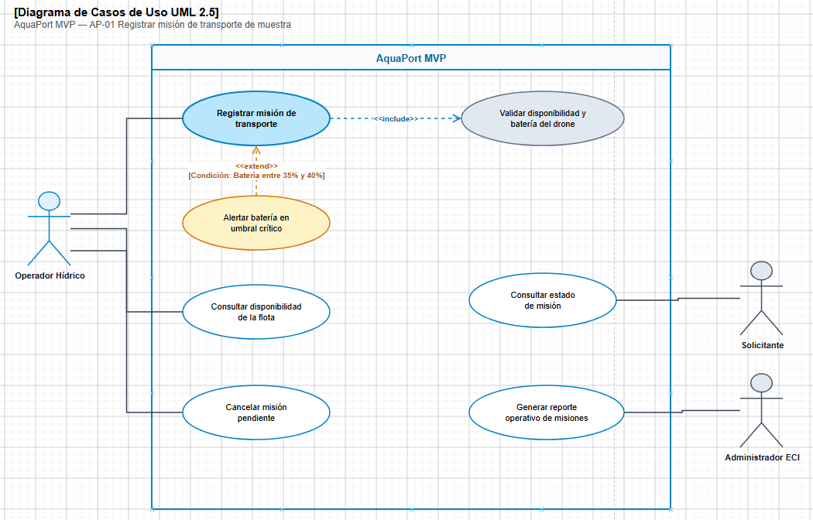

### Reto 11: Mocks con IA y Estados de Interfaz

Se generaron los diseños de alta fidelidad para el panel de monitoreo del operador utilizando inteligencia artificial, definiendo los tres estados operativos requeridos para el MVP a partir del manual de identidad y las especificaciones del requerimiento AP-01.

Aspectos modelados en los tres estados:
* Estado Normal (Operación estándar): Visualización de los cuatro drones con diversas condiciones de disponibilidad, selección del drone AR-03 con bloqueo del botón de asignación y advertencia explicativa por carga insuficiente (18% frente al 35% mínimo).
* Estado de Alerta (Incidencia técnica): Detección y destaque visual de fallo en el drone AR-04 en Laguna Sur mediante contenedor cromático diferenciado (#FF5C61) y banner preventivo superior para retirar la unidad de asignación.
* Estado Sin Disponibles (Saturación de flota): Representación de la flota con todas las unidades en misión activa, desactivación de acciones de despacho y componente informativo con sugerencia del siguiente drone próximo a liberarse.

Cumplimiento de usabilidad:
La verificación y cumplimiento de las heurísticas de Jakob Nielsen (#1, #2, #4, #5, #8 y #9) aplicadas en estos tres estados fue documentada y detallada previamente en la tabla del Reto 08.

#### Prompt utilizado para la generación

```text
Diseña 3 frames de escritorio para AquaPort, panel de flota de 4 drones acuáticos. Todo en español. Dashboard técnico oscuro, sin sombras ni fotos.
COLORES: fondo #08202E; superficie #0F3144, borde #1E4358; barra superior #0B4F6C; acento #19B5D1; texto #E4F0F5, secundario #9DB8C5. Estados (forma + texto): Disponible #34C77B círculo; En misión #4C9BFF rombo; Recargando #F5A524 gota; Mantenimiento #8C9AA3 cuadrado; Fallo #FF5C61 triángulo. FUENTES: IBM Plex Sans; JetBrains Mono para IDs y porcentajes.

ESTRUCTURA (igual en los 3):
Barra superior 64 px: "AquaPort" (Aqua #E4F0F5, Port #19B5D1) y "Operador Hídrico" a la derecha.
Título "Monitoreo de la flota" 28 px y 5 contadores de estado.
4 tarjetas en fila, 318x232 px, padding 20: ID (AR-01, mono 22 px) y chip de estado; barra de batería 8 px (roja si <35%); filas Batería y Zona.
Botón "Asignar a misión" 44 px alto, fondo #19B5D1, texto #04212B; deshabilitado #26434F. Mensaje al lado, 14 px en #FFC773. Seleccionada: borde 2 px #19B5D1. No asignables: opacidad 72%.

FRAME "01 Normal" (AR-03 seleccionada): AR-01 Disponible 86% Laboratorio Hídrico; AR-02 En misión 62% Canal Central; AR-03 Recargando 18% Embalse Norte; AR-04 Mantenimiento 74% Laguna Sur. Botón deshabilitado, mensaje: "El drone AR-03 tiene batería insuficiente (18%). Mínimo requerido: 35%."

FRAME "02 Alerta": igual, pero AR-03 Recargando 41% y AR-04 Fallo 55% Laguna Sur (borde #FF5C61, fondo #2A1A20). Banner bajo el título (fondo #3A1519, borde #FF5C61, texto #FFD6D8): "AR-04 reporta fallo en Laguna Sur. Retira el drone de la asignación."

FRAME "03 Sin disponibles": 4 drones En misión (AR-01 78% Punto Ribereño Este; AR-02 62% Canal Central; AR-03 90% Embalse Norte; AR-04 67% Laguna Sur). Mensaje "Selecciona un drone para continuar." Bloque de borde punteado: "No hay drones disponibles. AR-02 es el siguiente en liberarse."

Cumple Nielsen #1, #2, #4, #5, #8, #9. Usa auto layout y estilos reutilizables.
```

#### Evidencias de los Tres Estados del Panel


### Reto 12: Desarrollo Guiado por Pruebas (TDD) en ValidadorMision

Se implementó el componente de validación de reglas de negocio ValidadorMision siguiendo el ciclo estricto de TDD (Red, Green, Refactor) con JUnit 5 y el patrón Arrange-Act-Assert (AAA).

Fases del ciclo ejecutadas:
* Fase Red (Pruebas primero): Se escribieron anticipadamente las pruebas unitarias en ValidadorMisionTest especificando los escenarios esperados antes de consolidar el código de producción.
* Fase Green (Código mínimo): Se construyeron los métodos tieneBateriaSuficiente, validarPuntoPartida, validarPuntoLlegada y validar, permitiendo que la suite completa de 14 pruebas pasara exitosamente.
* Fase Refactor (Optimización y diseño limpio): Se modularizó la lógica de verificación de zonas a través del método privado validarZona, centralizando mensajes descriptivos en español y eliminando duplicación de código sin alterar el comportamiento observable.

Escenarios de prueba validados:
* Asignación permitida para drones con batería mayor al 35% y en el umbral exacto del 35%.
* Bloqueo inmediato para drones con batería crítica (< 35%) o en estado nulo.
* Excepciones de tipo IllegalArgumentException ante puntos de partida o llegada nulos o en blanco.
* Manejo de casos de borde (edge cases) para ubicaciones no pertenecientes a las zonas hídricas oficiales del campus.
* Restricción operativa que impide registrar misiones donde el punto de partida y llegada sean idénticos.
* Trazabilidad de commits: Registro histórico con commits independientes para la especificación de pruebas (RED), la implementación funcional (GREEN) y la optimización estructural (REFACTOR).

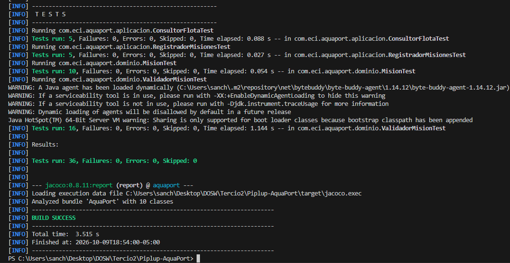

### Reto 13: Cobertura de Código con JaCoCo

Se configuró el plugin de JaCoCo en el ciclo de construcción de Maven para medir, auditar y garantizar la cobertura de pruebas unitarias sobre la lógica de negocio del sistema.

Métricas y resultados obtenidos:
* Umbral mínimo requerido: 80% de cobertura de líneas.
* Cobertura alcanzada en ValidadorMision: 100% en instrucciones, 100% en ramas de decisión (20 de 20 ramas) y 100% en líneas de código.
* Cobertura global del paquete de dominio (com.eci.aquaport.dominio): 100% en instrucciones (433 de 433) y 100% en ramas (46 de 46).
* Ausencia de ramas parciales o código muerto en las validaciones de negocio.
* Generación automatizada del reporte HTML en target/site/jacoco/index.html en cada ejecución de la fase de pruebas.

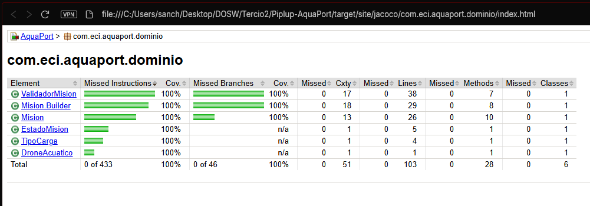

### Reto 14: Análisis Estático con SonarQube

Se realizó la auditoría de calidad de código mediante análisis estático con SonarQube, asegurando el cumplimiento del estándar de calidad definido para el nivel Piplup (MVP).

Métricas y objetivos de calidad:
* 0 Bugs identificados en la lógica de negocio y persistencia.
* 0 Vulnerabilidades de seguridad.
* Deuda técnica en 0 minutos para el alcance del MVP.
* Resolución de Code Smells: Se refactorizó la clase NotificadorOperadorConsola eliminando el uso de flujos estándar directos (System.out y System.err - regla java:S106), sustituyéndolos por un Logger parametrizado con niveles semánticos INFO y SEVERE para evitar degradación de rendimiento y permitir redirección de trazas.
* Sin supresión artificial: Ningún issue fue ocultado mediante anotaciones @SuppressWarnings, resolviendo cada hallazgo en su causa raíz.

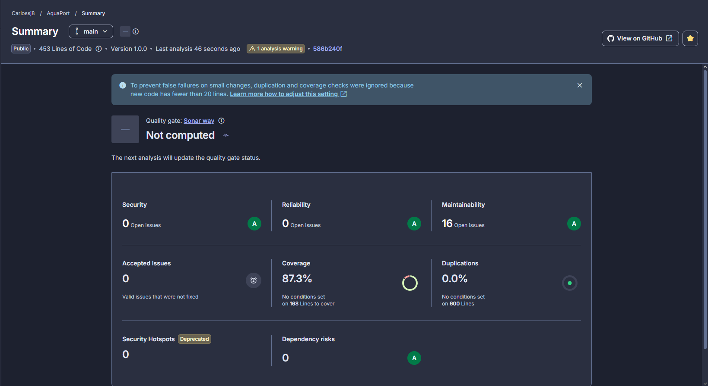

## Nivel 2: Prinplup (Flota Autónoma y Alertas)

En esta segunda etapa del sistema se escala la flota a 15 drones distribuidos en tres tipos especializados (Superficial, Semisumergido y Buceador), incorporando asignación autónoma por condiciones hídricas, precedencia para misiones críticas y notificación en tiempo real ante eventos de fallo.

### Reto 01: Streams Avanzados sobre Flota de 15 Drones

Se implementó el componente ConsultorFlotaAvanzado aplicando operaciones avanzadas de la API de Streams para procesar, categorizar y optimizar la toma de decisiones sobre la flota ampliada.

Aspectos implementados:
* Enriquecimiento del modelo con el enum TipoDrone (Superficial, Semisumergido, Buceador) con capacidades de carga específicas y el enum Prioridad (Crítica, Alta, Normal, Baja).
* Agrupación de drones disponibles por tipo de unidad mediante Collectors.groupingBy.
* Determinación del drone óptimo para una zona específica combinando filtros de zona, compatibilidad técnica y selección de mayor batería mediante Comparator y max.
* Cálculo del promedio de carga de batería por tipo de drone a través de Collectors.averagingDouble.
* Separación de misiones críticas mediante Collectors.partitioningBy para garantizar tratamiento prioritario en el despacho.
* Extracción y ordenamiento de las zonas geográficas únicas cubiertas por la flota activa usando map, distinct y sorted.
* Validación automatizada mediante pruebas unitarias exhaustivas en ConsultorFlotaAvanzadoTest.

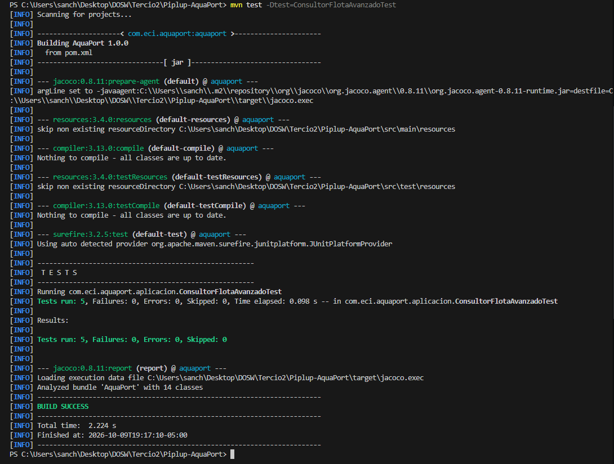

### Reto 02: GitFlow Completo con Release y Hotfix (v2.0)

Se documentó y estructuró la estrategia integral de ramificación bajo el modelo GitFlow para el ciclo de vida de la versión 2.0, garantizando la estabilidad de producción y el desarrollo paralelo de funcionalidades autónomas.

Estructura de ramas y ciclo de integración:
* Rama main: Aloja el código productivo estable, etiquetado formalmente con versiones semánticas (v1.0.0 y v2.0.0).
* Rama develop: Rama de integración continua receptora de las funcionalidades aprobadas.
* Ramas de características (features):
  * feature/asignacion-automatica: Implementación de la estrategia de selección de drones.
  * feature/alertas-centro-control: Notificación por observadores ante estados de fallo.
  * feature/factory-drones: Factoría para instanciación de los 3 tipos de unidades especializadas.
* Rama de estabilización (release/v2.0): Congelamiento de código para ajustes menores, preparación de changelog y pruebas finales previo al despliegue.
* Rama de corrección urgente (hotfix/fix-bateria-critica): Ramificación directa desde main para solventar incidentes críticos en producción, reintegrándose tanto en main como en develop.
* Etiquetado semántico: Generación del tag v2.0.0 en main al completar la fusión de la release.

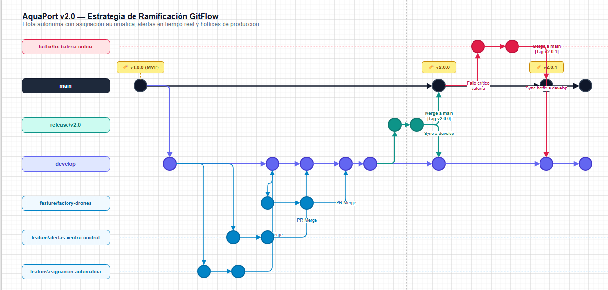

### Reto 03: Patrones de Diseño (Strategy, Observer y Factory Method)

Se implementó la arquitectura de asignación autónoma de la versión 2.0 integrando tres patrones de diseño de software para garantizar extensibilidad, bajo acoplamiento y reactividad ante fallos.

Patrones implementados de forma coordinada:
* Factory Method (FabricaDrones): Centraliza la instanciación de los tres tipos especializados de drones (Superficial, Semisumergido y Buceador), asignando automáticamente modelos, zonas y capacidades de carga según la especialidad.
* Strategy (EstrategiaSeleccion): Desacopla el algoritmo de elección del drone óptimo. Se implementaron las estrategias MayorBateriaStrategy y PrioridadCriticaStrategy, ejecutando selección polimórfica en AsignadorAutomatico sin incurrir en violaciones de diseño con condicionales instanceof.
* Observer (ObservadorMision): Establece el canal de notificación desacoplado para eventos operativos. Los observadores CentroControlObserver y TecnicoMantenimientoObserver son alertados en tiempo real ante asignaciones confirmadas o incidencias.
* Verificación con Mockito: Pruebas unitarias en AsignadorAutomaticoTest comprobando mediante dobles de prueba y verify que ante eventos de fallo todos los observadores registrados son notificados exactamente una vez.

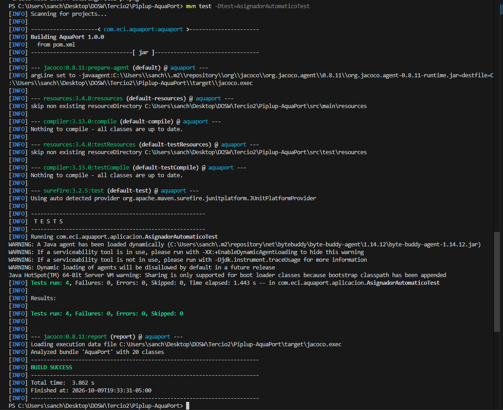

### Reto 04: Auditoría y Aplicación Integral de Principios SOLID

Se auditó la arquitectura orientada a la versión 2.0 garantizando el cumplimiento de los cinco principios SOLID sobre las nuevas clases, interfaces y jerarquías de dominio y aplicación.

#### Análisis por principio

1. Principio de Responsabilidad Única (SRP):
   * Clases involucradas: AsignadorAutomatico, MayorBateriaStrategy, FabricaDrones y CentroControlObserver.
   * Dónde y cómo se cumple: AsignadorAutomatico únicamente orquesta el flujo de asignación y despacho de eventos; los algoritmos de ordenamiento residen en sus estrategias correspondientes; la instanciación de unidades está aislada en FabricaDrones; y la presentación o logging de alertas compete en exclusiva a cada observador.
   * Importancia en AquaPort: Evita clases utilitarias o monolíticas propensas a cambios ante modificaciones en el algoritmo de cálculo o en los canales de alerta.

2. Principio de Abierto/Cerrado (OCP):
   * Clases involucradas: AsignadorAutomatico, EstrategiaSeleccion, FabricaDrones.
   * Dónde y cómo se cumple: AsignadorAutomatico está cerrado a modificaciones pero abierto a extensiones; la incorporación de nuevas estrategias (por ejemplo, basadas en proximidad física o consumo energético) no requiere alterar una sola línea del orquestador.
   * Importancia en AquaPort: Permite escalar la lógica de decisión de la flota sin riesgo de regresión en las operaciones existentes.

3. Principio de Sustitución de Liskov (LSP):
   * Clases involucradas: DroneAcuatico y sus especializaciones (Superficial, Semisumergido, Buceador).
   * Dónde y cómo se cumple: Cualquier unidad creada por la factoría cumple la totalidad de las invariantes y contratos de DroneAcuatico; ningún tipo especializado altera el comportamiento base, no introduce excepciones inesperadas y puede ser procesado uniformemente por repositorios y validadores.
   * Importancia en AquaPort: Asegura interoperabilidad en toda la flota sin necesidad de verificar el tipo concreto durante el despacho.

4. Principio de Segregación de Interfaces (ISP):
   * Clases involucradas: EstrategiaSeleccion, ObservadorMision, RepositorioMisiones.
   * Dónde y cómo se cumple: Se diseñaron interfaces cohesivas de propósito específico. EstrategiaSeleccion expone un único método de selección; ObservadorMision solo declara métodos de escucha de eventos; ninguna clase se ve obligada a depender de métodos que no consume.
   * Importancia en AquaPort: Mantiene contratos limpios y facilita la creación de dobles de prueba (mocks y stubs) sin sobrecarga de implementación.

5. Principio de Inversión de Dependencias (DIP):
   * Clases involucradas: AsignadorAutomatico y RegistradorMisiones.
   * Dónde y cómo se cumple: Los servicios de alto nivel dependen de abstracciones (EstrategiaSeleccion, ObservadorMision, RepositorioMisiones) y no de implementaciones concretas, inyectadas directamente mediante constructor.
   * Importancia en AquaPort: Facilita el cambio dinámico de infraestructura (almacenamiento en base de datos vs. memoria) y desacopla la lógica de negocio de los detalles técnicos.

### Reto 05: Diagrama de Contexto C4 (Nivel 1 - Versión 2.0)

Se actualizó el diagrama de contexto C4 incorporando la evolución del sistema hacia la autonomía, integrando nuevos actores y conectando por primera vez con sistemas externos de soporte ambiental y control institucional.

Evolución frente al MVP (Nivel 1 Piplup):
* Elementos que se mantuvieron: El sistema central AquaPort como núcleo gestor y los actores Operador Hídrico, Solicitante y Administrador ECI.
* Elementos que crecieron:
  * Nuevo Actor: Técnico de Mantenimiento, responsable de atender fallas técnicas e inspeccionar unidades fuera de servicio.
  * Nuevo Sistema Externo: API de Condiciones Hídricas, proveedora de telemetría sobre nivel de agitación, profundidad y turbidez de los cuerpos de agua.
  * Nuevo Sistema Externo: Centro de Control ECI, entidad institucional para registro y autorización de navegación hídrica en canales del campus.
  * Nuevo Sistema Externo: Sistema de Alertas, plataforma de mensajería para notificación de incidencias críticas en tiempo real.

Flujos e intercambios de datos etiquetados:
* AquaPort v2 -> API Condiciones Hídricas: Consulta de parámetros ambientales y estado de oleaje.
* API Condiciones Hídricas -> AquaPort v2: Retorno de datos de agitación y profundidad por zona.
* AquaPort v2 -> Centro de Control ECI: Solicitud de autorización de ruta y registro de misión.
* Centro de Control ECI -> AquaPort v2: Autorización de zarpe y directrices de navegación.
* AquaPort v2 -> Sistema de Alertas: Despacho automático de evento de fallo técnico.
* Sistema de Alertas -> Técnico de Mantenimiento: Notificación de drone averiado y ubicación de rescate.
* Técnico de Mantenimiento -> AquaPort v2: Actualización de estado del drone a mantenimiento o reparado.

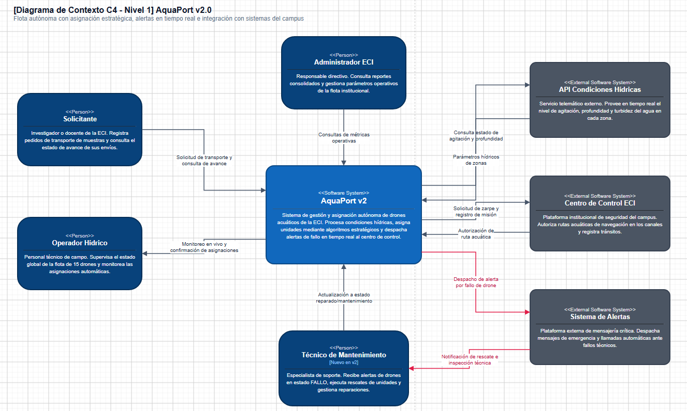

### Reto 06: Requisitos Funcionales, No Funcionales y MoSCoW (v2.0)

Se definieron los requisitos para las capacidades autónomas y de monitoreo ambiental de la versión 2.0, analizando las tensiones de diseño y priorizando las entregas bajo la metodología MoSCoW.

#### Requisitos Funcionales (RF)
* RF-04 (Asignación automática de drones): El sistema evalúa la flota activa y asigna de manera autónoma el drone más apto según la estrategia vigente (mayor batería o aptitud por criticidad), notificando el resultado al operador y persistiendo la asignación.
* RF-05 (Notificación automática de alertas de fallo): El sistema despacha automáticamente una alerta en tiempo real a los observadores suscritos (Centro de Control y Técnico de Mantenimiento) ante la detección de un drone en estado FALLO o cuando una misión crítica no encuentra unidades aptas.
* RF-06 (Consulta de condiciones hídricas ambientales): El sistema consulta los parámetros de oleaje, turbidez y profundidad a la API externa de Condiciones Hídricas previo a autorizar el despacho hacia una zona hídrica.
* RF-07 (Gestión técnica por Técnico de Mantenimiento): El Técnico de Mantenimiento consulta el registro de unidades con fallas reportadas y actualiza su estado operativo a Mantenimiento o Disponible una vez culminada la inspección física.

#### Requisitos No Funcionales (RNF)
* RNF-04 (Latencia de asignación autónoma): El algoritmo de asignación automática debe determinar la unidad óptima en menos de 400 milisegundos para una flota de hasta 30 drones, medido mediante JUnit 5 y assertTimeout.
* RNF-05 (Tiempo de propagación de alertas): La notificación de fallo técnico debe emitirse a todos los observadores registrados en un lapso inferior a 100 milisegundos a partir de la detección del evento.
* RNF-06 (Resiliencia ante fallos externos): La comunicación con la API externa de Condiciones Hídricas debe poseer un tiempo límite de espera (timeout) de 500 milisegundos y un mecanismo de contingencia con parámetros seguros por defecto ante caída del servicio externo.
* RNF-07 (Calidad estática y deuda técnica): La base de código de la versión 2.0 debe mantener 0 bugs, 0 vulnerabilidades y una deuda técnica inferior a 30 minutos según el análisis estático en SonarQube/SonarCloud.

#### Análisis de Tensión entre Requisitos (AP-07 vs. AP-08)
* Tensión identificada: El requisito AP-07 estipula seleccionar siempre el drone con mayor batería disponible, mientras que AP-08 exige que las misiones CRÍTICAS reciban el drone técnicamente más apto para la zona (por ejemplo, Drone Semisumergido en aguas agitadas o Buceador para toma profunda), independientemente de si otra unidad posee un porcentaje mayor de carga.
* Resolución arquitectónica: Se implementa precedencia jerárquica gobernada por el patrón Strategy. Para misiones de prioridad NORMAL o BAJA rige la estrategia MayorBateriaStrategy. Para misiones CRÍTICAS, la estrategia PrioridadCriticaStrategy filtra en primer orden los drones técnicamente compatibles con las condiciones y profundidad de la zona, y únicamente entre ese subconjunto apto selecciona el de mayor carga de batería, garantizando viabilidad técnica sin comprometer la seguridad de la misión.

#### Priorización MoSCoW v2.0

| Requisito | Tipo | Prioridad MoSCoW | Justificación |
| :--- | :--- | :--- | :--- |
| RF-04 | Funcional | Must Have | Es el núcleo de valor de la versión 2.0 al transicionar de despacho manual a flota autónoma. |
| RF-05 | Funcional | Must Have | Esencial para la seguridad física de las unidades ante fallas e imposibilidad de asignación. |
| RNF-04 | No Funcional | Must Have | Crítico para evitar cuellos de botella en la atención de solicitudes concurrentes de transporte. |
| RNF-05 | No Funcional | Must Have | Indispensable para que el centro de control reaccione inmediatamente ante averías en el agua. |
| RF-06 | Funcional | Should Have | Importante para la toma informada de decisiones según el estado del cuerpo hídrico. |
| RF-07 | Funcional | Should Have | Relevante para reincorporar drones reparados al ciclo operativo de la flota. |
| RNF-06 | No Funcional | Should Have | Necesario para aislar el sistema central de caídas temporales de la API ambiental externa. |
| RNF-07 | No Funcional | Could Have | Deseable para preservar la salud estructural del código previa a la versión multi-embalse. |

### Reto 07: Plantilla DOSW para Asignación Automática (AP-07)

Se documentó detalladamente la especificación formal del requerimiento funcional AP-07 utilizando el estándar de la plantilla institucional DOSW, alojada en el repositorio en `docs/word/detalleRequerimientoPrinplup.docx`.

Aspectos documentados en la plantilla:
* Código y nombre: AP-07 Asignar automáticamente drone a misión hídrica.
* Actor: Sistema (proceso autónomo supervisado por el Operador Hídrico).
* Estructura jerárquica de datos de entrada: Tipos de datos reales y sub-atributos anidados:
  * carga.peso: Integer (1 a 1500 gramos).
  * carga.tipo: Enum (MUESTRA_AGUA, SENSOR, PAQUETE_LIGERO, EQUIPO_MEDICION).
  * carga.prioridad: Enum (CRITICA, ALTA, NORMAL, BAJA).
  * zonaDestino: Enum (EMBALSE_NORTE, CANAL_CENTRAL, LAGUNA_SUR, RIBERA_ESTE, LAB_HIDRICO).
* Datos calculados de salida:
  * droneAsignado.id: String (formato AR-XX).
  * droneAsignado.tipo: String (SUPERFICIAL, SEMISUMERGIDO, BUCEADOR).
* Flujo básico de 7 pasos: Recepción de solicitud -> consulta de condiciones hídricas -> filtrado de drones aptos por zona -> aplicación de estrategia activa -> validaciones multinivel (batería, capacidad y compatibilidad) -> asignación formal -> despacho de notificaciones a observadores.
* Flujos alternos: Manejo de escenarios sin drones disponibles, condiciones ambientales adversas en el cuerpo hídrico y exceso de capacidad de carga respecto al tipo de drone.
* Reglas de negocio: Umbral estricto de batería mínima del 35% y restricción de peso máximo de 300g para unidades de tipo Buceador.

### Reto 08: Sistema de Diseño v2 y Leyes UX Aplicadas

Se extendió el sistema de diseño de AquaPort para la versión 2.0, modelando componentes con estados exhaustivos y aplicando leyes fundamentales de experiencia de usuario para optimizar la toma de decisiones del operador.

Componentes del sistema de diseño:
* Componente Tarjeta de Drone Acuático con sus 6 estados operativos:
  * Disponible: Borde y chip verde (#34C77B) con indicador de zarpe habilitado.
  * En Misión: Borde y chip azul (#4C9BFF) con ruta y tiempo estimado visible.
  * Recargando: Borde y chip ámbar (#F5A524) con porcentaje de carga activa.
  * Mantenimiento: Borde y chip gris (#8C9AA3) con acceso a bitácora de taller.
  * Fallo: Borde y chip rojo (#FF5C61) con contenedor de alerta e indicador de rescate.
  * Sumergido: Borde y chip azul oscuro (#1D4ED8) con telemetría de profundidad.
* Componente Indicador de Batería con tres umbrales visuales: verde (>= 60%), ámbar (35% a 59%) y rojo (< 35% con bloqueo preventivo).
* Componente Botón de Asignación con 5 estados: Default, Hover, Procesando (spinner), Éxito y Deshabilitado.

Aplicación de Leyes UX:
* Ley de Fitts: Ubicación prominente y tamaño optimizado para el botón de asignación y el comando de aborto de emergencia en la barra superior, reduciendo el tiempo de adquisición del objetivo interactivo.
* Ley de Hick: Categorización de la flota de 15 drones en tres grupos especializados (Superficial, Semisumergido, Buceador) mediante pestañas de filtrado, reduciendo el número de alternativas inmediatas y el tiempo de reacción del operador.
* Ley de Miller: Fragmentación de la información de cada drone en trozos (chunks) de 5 atributos críticos (Identificador, Tipo, Batería, Zona actual y Estado), evitando sobrecargar la memoria de trabajo del usuario.

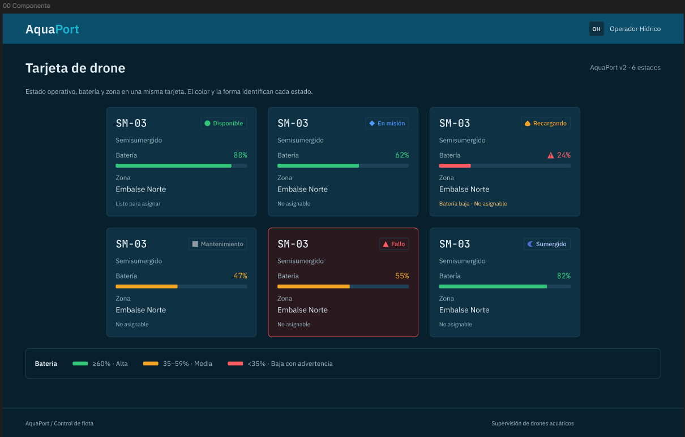
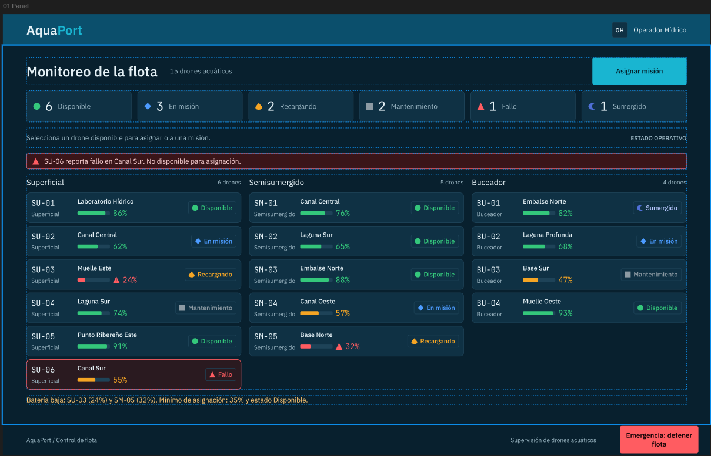
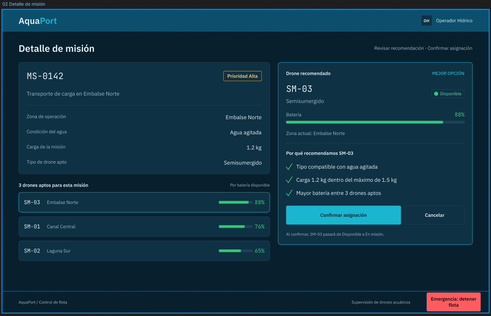
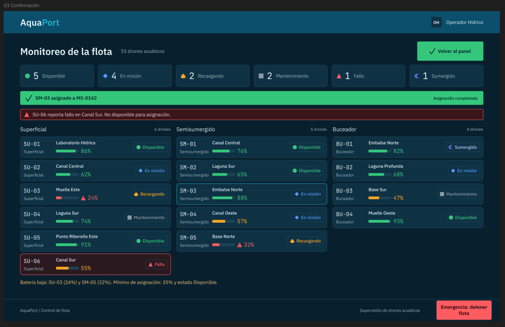

### Reto 09: Planificación del Sprint y Gestión Ágil v2 en Jira

Se planificó y activó el sprint de la versión 2.0 en Jira alineando la capacidad del equipo con los objetivos de valor, aplicando estimación en puntos de historia y formalizando los criterios de aceptación y calidad.

Aspectos planificados en el sprint:
* Objetivo del Sprint (Sprint Goal): Completar el asignador automático con Strategy y las alertas con Observer.
* Estimación por Story Points (Secuencia Fibonacci):
  * HU-04 (Asignación automática de drones mediante Strategy): 5 Story Points.
  * HU-05 (Despacho de alertas a Centro de Control y Mantenimiento con Observer): 3 Story Points.
  * HU-06 (Consulta y validación de condiciones hídricas ambientales): 3 Story Points.
  * HU-07 (Gestión y reincorporación de flota por Técnico de Mantenimiento): 2 Story Points.
* Definition of Done (DoD) estricto de la versión 2.0:
  * El código compila limpiamente sin advertencias del compilador.
  * La totalidad de las pruebas unitarias y de integración pasan con éxito en JUnit 5.
  * Cobertura mínima de líneas auditada por JaCoCo mayor o igual al 80% sobre las funcionalidades del sprint.
  * Pull Request con revisión y aprobación de al menos otro integrante del equipo.
  * Actualización sincronizada de los diagramas de arquitectura C4 y la plantilla de requerimientos DOSW.

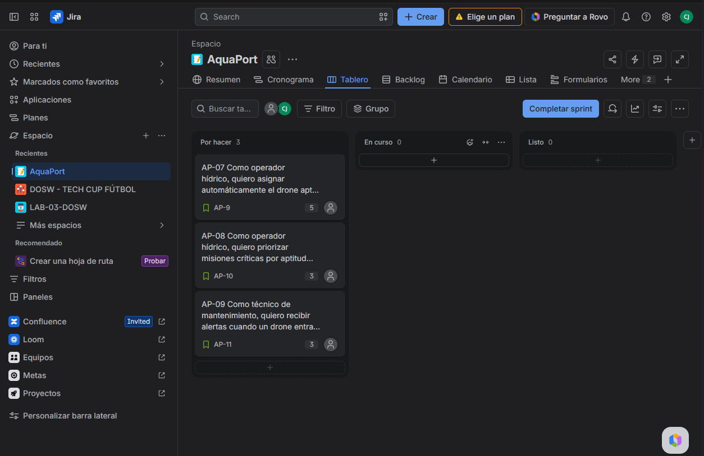

### Reto 10: Diagrama de Casos de Uso Extendido v2

Se expandió el modelo de casos de uso UML para reflejar la dinámica de la flota autónoma, incorporando la participación del Técnico de Mantenimiento y del Centro de Control, junto con encadenamientos de dependencias obligatorias y condicionales.

Aspectos modelados:
* Casos de uso de la versión 2.0:
  * Asignar misión automáticamente (Caso de uso nuclear autónomo).
  * Validar condiciones hídricas ambientales.
  * Seleccionar drone óptimo mediante estrategia.
  * Notificar fallo al técnico de mantenimiento.
  * Despachar alerta prioritaria al Centro de Control.
  * Registrar retorno o reparación de unidad.
* Actores involucrados: Operador Hídrico, Solicitante, Administrador ECI, Técnico de Mantenimiento y Centro de Control.
* Relaciones «include» obligatorias:
  * Asignar misión automáticamente incluye Validar condiciones hídricas ambientales (requisito previo no condicional).
  * Asignar misión automáticamente incluye Seleccionar drone óptimo mediante estrategia.
* Relaciones «extend» condicionales:
  * Notificar fallo al técnico de mantenimiento extiende Asignar misión automáticamente, disparándose únicamente si la estrategia detecta un drone en estado FALLO o imposibilidad de asignación.
  * Despachar alerta prioritaria al Centro de Control extiende Asignar misión automáticamente bajo la condición de que la misión cuente con Prioridad CRÍTICA.

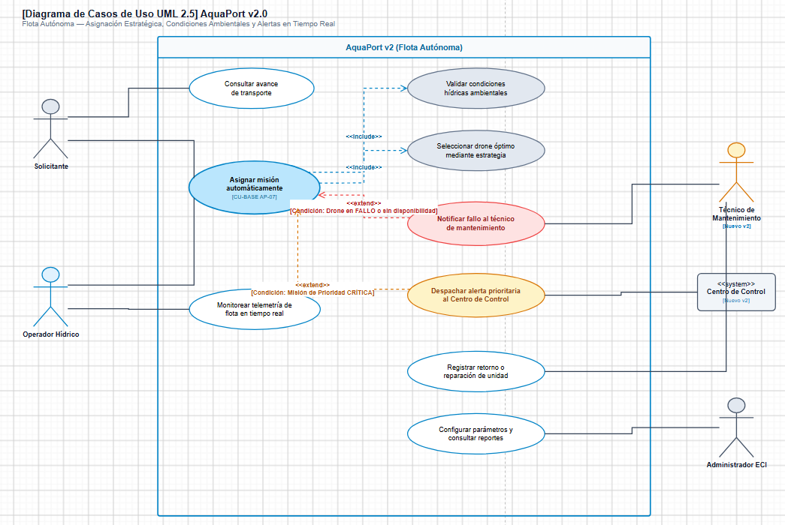

### Reto 11: Mocks de Asignación en 3 Pantallas

Se diseñaron los prototipos visuales de alta fidelidad que modelan la interacción del operador con el sistema de asignación automática de drones en tres escenarios operativos clave:

Estados modelados:
* Estado Normal (Happy Path): Visualización de solicitud con asignación confirmada, telemetría de batería en niveles óptimos (>70%), trazado de ruta despejado y confirmación de despacho al operador.
* Estado Alerta (Prioridad Crítica): Despliegue de misión de alta prioridad sin unidades inmediatas en el punto de recolección, activación de banners de advertencia visual y reasignación de ruta prioritaria con notificación a Centro de Control.
* Estado Sin Disponibles: Escenario de contingencia operativa con saturación de flota, alertas visuales de indisponibilidad técnica, cola de misiones en espera y sugerencias de rebalanceo de unidades.

#### P1
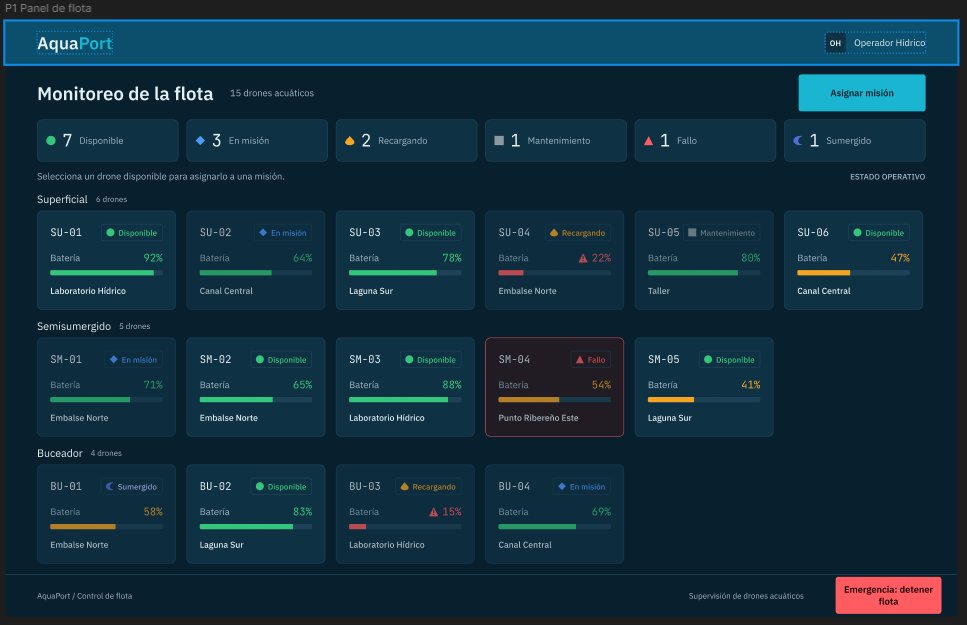

Prompt usado:
Continuando con AquaPort v2, usa los mismos colores, fuentes y estilos de este chat. Crea el frame "P1 Panel de flota" 1440x900, todo en español.

Barra superior y fila de contadores como antes (Disponible 7, En misión 3, Recargando 2, Mantenimiento 1, Fallo 1, Sumergido 1). Arriba a la derecha, botón "Asignar misión" (#19B5D1). Botón fijo abajo a la derecha "Emergencia: detener flota", 160x56 px, fondo #FF5C61, texto #1A0507.

15 drones en 3 secciones con título y conteo, tarjetas de 210x150 px en una fila por sección. Cada tarjeta: ID mono, chip de estado (forma + texto), batería con barra (≥60% verde, 35-59% amarillo, <35% rojo con advertencia) y zona.

Superficial (6): SU-01 Disponible 92% Laboratorio Hídrico; SU-02 En misión 64% Canal Central; SU-03 Disponible 78% Laguna Sur; SU-04 Recargando 22% Embalse Norte; SU-05 Mantenimiento 80% Taller; SU-06 Disponible 47% Canal Central.
Semisumergido (5): SM-01 En misión 71% Embalse Norte; SM-02 Disponible 65% Embalse Norte; SM-03 Disponible 88% Laboratorio Hídrico; SM-04 Fallo 54% Punto Ribereño Este (borde #FF5C61); SM-05 Disponible 41% Laguna Sur.
Buceador (4): BU-01 Sumergido 58% Embalse Norte (#4F6FD6, media luna); BU-02 Disponible 83% Laguna Sur; BU-03 Recargando 15% Laboratorio Hídrico; BU-04 En misión 69% Canal Central.

Sin imágenes ni sombras. Las tarjetas no disponibles con opacidad 72%.

#### P2
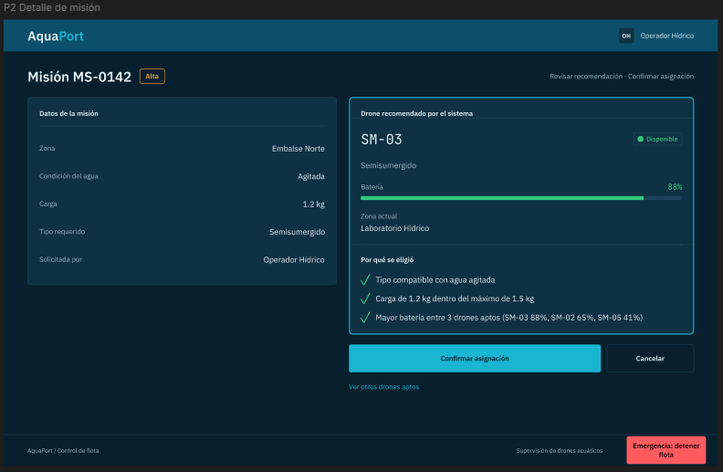


Prompt usado:
Continuando con AquaPort v2, usa los mismos colores, fuentes y estilos de este chat. Crea el frame "P2 Detalle de misión" 1440x900, todo en español. Mantén la barra superior y el botón fijo "Emergencia: detener flota" (160x56 px, #FF5C61) abajo a la derecha.

Título "Misión MS-0142" y, al lado, chip de prioridad "Alta" en #F5A524. Dos columnas.

Columna izquierda, tarjeta "Datos de la misión": Zona: Embalse Norte; Condición del agua: Agitada; Carga: 1.2 kg; Tipo requerido: Semisumergido; Solicitada por: Operador Hídrico.

Columna derecha, tarjeta "Drone recomendado por el sistema", borde 2 px #19B5D1: ID SM-03 en mono 28 px, chip Disponible, Semisumergido, batería 88% con barra verde, zona actual Laboratorio Hídrico. Debajo, bloque "Por qué se eligió" con 3 puntos con icono de check verde:
- Tipo compatible con agua agitada
- Carga de 1.2 kg dentro del máximo de 1.5 kg
- Mayor batería entre 3 drones aptos (SM-03 88%, SM-02 65%, SM-05 41%)

Abajo de la columna derecha: botón "Confirmar asignación" (56 px de alto, fondo #19B5D1, texto #04212B) y a su lado botón secundario "Cancelar" con borde #1E4358. Enlace de texto "Ver otros drones aptos" en #19B5D1.

Sin imágenes ni sombras.

#### P3
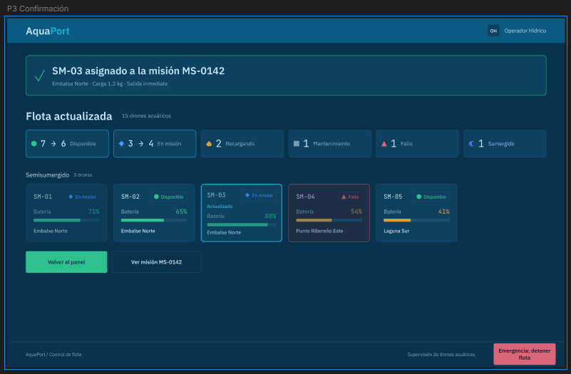


Prompt usado:
Continuando con AquaPort v2, usa los mismos colores, fuentes y estilos de este chat. Crea el frame "P3 Confirmación" 1440x900, todo en español. Mantén la barra superior y el botón fijo "Emergencia: detener flota" (160x56 px, #FF5C61) abajo a la derecha.

Banner de ancho completo, fondo #0F3144, borde 1 px #34C77B, icono de check verde: "SM-03 asignado a la misión MS-0142" y debajo en #9DB8C5: "Embalse Norte · Carga 1.2 kg · Salida inmediata".

Debajo, título "Flota actualizada" y contadores: Disponible 6, En misión 4, Recargando 2, Mantenimiento 1, Fallo 1, Sumergido 1. Resalta con borde #19B5D1 los contadores que cambiaron (Disponible bajó de 7 a 6, En misión subió de 3 a 4) mostrando "7 → 6" y "3 → 4".

Debajo, el grupo Semisumergido (5 tarjetas de 210x150 px) con SM-03 ahora En misión, 88%, Embalse Norte, resaltada con borde 2 px #19B5D1 y la etiqueta "Actualizado": SM-01 En misión 71%; SM-02 Disponible 65%; SM-03 En misión 88%; SM-04 Fallo 54% (borde #FF5C61); SM-05 Disponible 41%.

Botones: "Volver al panel" (estado de éxito, fondo #34C77B, texto #04212B, 56 px) y "Ver misión MS-0142" (secundario con borde).

Sin imágenes ni sombras.


### Reto 12: TDD con Mockito para el AsignadorAutomático

Se implementó el ciclo Test-Driven Development (TDD) para el componente central `AsignadorAutomatico`, desacoplando colaboradores externos mediante Mockito (`@Mock`, `@InjectMocks`, `when`, `verify`).

Pruebas unitarias y de comportamiento implementadas:
* Asignación exitosa (Happy path): Verificación de que una selección favorable notifica exclusivamente `notificarAsignacionExitosa` a los observadores registrados y no dispara eventos de fallo.
* Misión CRÍTICA sin drones: Comprobación de que una misión de prioridad crítica sin unidades aptas genera una alerta de fallo urgente hacia el Centro de Control y Mantenimiento.
* Drone en FALLO durante asignación: Detección de una unidad con fallo técnico devuelta por la selección, despacho de notificación técnica a los observadores y ejecución de una búsqueda automática de drone alternativo en la flota restante.
* Lista de drones vacía: Validación de que flotas nulas o sin elementos notifican fallo preventivo de inmediato sin invocar la estrategia de selección.
* Batería en el umbral mínimo (35%): Prueba de caso edge que confirma que un drone con exactamente 35% de batería es asignado satisfactoriamente, contrastando con el caso de 34% que es rechazado de inmediato.
* Casos adicionales de robustez: Validación de exclusión de observadores removidos, control de argumentos nulos (`IllegalArgumentException` y `NullPointerException`) y despacho manual de fallos imprevistos.

Cobertura de código obtenida en el componente:
* Instrucciones (Bytecode): 100% de cobertura.
* Ramas de decisión (Branches): 93% de cobertura auditada por JaCoCo.

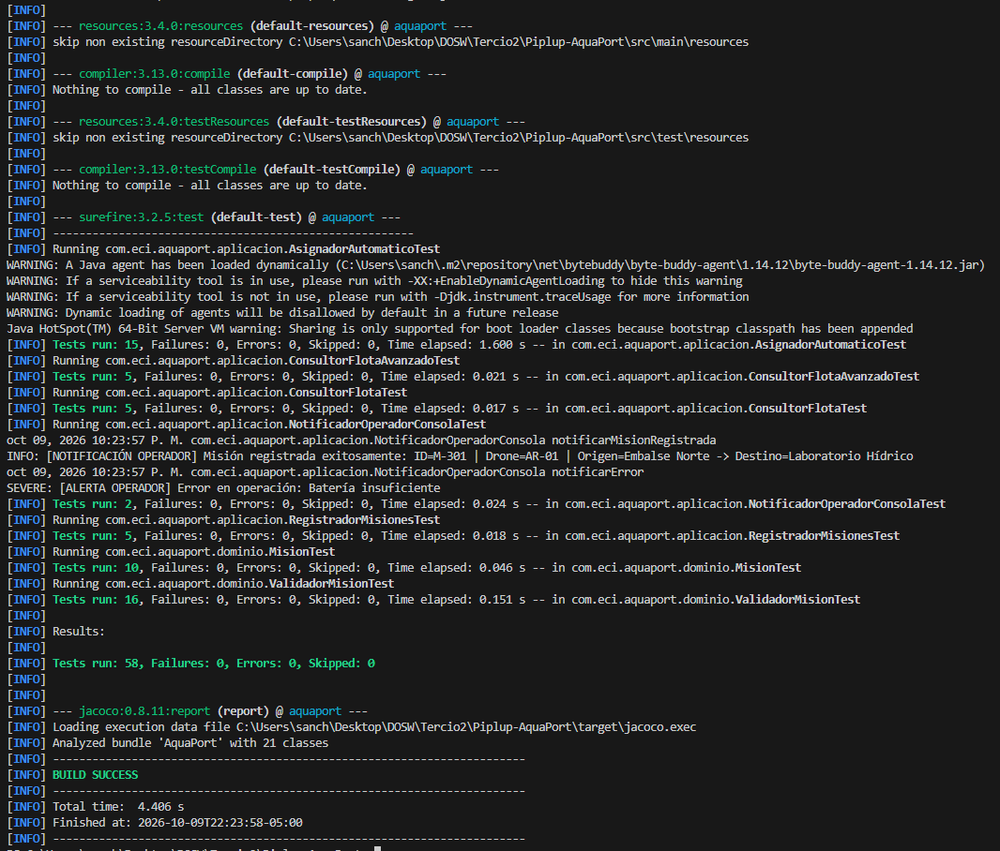

### Reto 13: JaCoCo Quality Gate y Cobertura de Dominio v2

Se configuró un Quality Gate estricto en el plugin `jacoco-maven-plugin` de Maven para asegurar que el build falle automáticamente si la cobertura de líneas o de ramas cae por debajo del 80% (0.80).

Configuración del Quality Gate en `pom.xml`:
* Fase de ejecución: `verify`.
* Meta: `check`.
* Límites de control:
  * `LINE` ratio mínimo: 0.80 (80%).
  * `BRANCH` ratio mínimo: 0.80 (80%).

Métricas globales auditadas tras ejecución de pruebas:
* Proyecto consolidado: 90% de cobertura de instrucciones y 92% de cobertura de ramas (70 pruebas unitarias en verde).
* Paquete `com.eci.aquaport.dominio`: 99% de instrucciones y 98% de ramas.
* Paquete `com.eci.aquaport.aplicacion`: 85% de instrucciones y 91% de ramas.

Resolución de ramas amarillas (parcialmente cubiertas):
* `FabricaDrones`: Se desarrollaron pruebas unitarias (`FabricaDronesTest`) para verificar las bifurcaciones defensivas de tipo nulo e identificador nulo o vacío (`IllegalArgumentException`), elevando la clase al 100% de ramas.
* `PrioridadCriticaStrategy`: Se cubrieron todas las ramas condicionales en `PrioridadCriticaStrategyTest`, incluyendo el caso de misión crítica sin drones en zona que recurre al de mayor batería general, misiones normales y listas de flota nulas o vacías.
* `MayorBateriaStrategy`: Se implementaron pruebas específicas para flotas nulas/vacías y exclusión de drones inactivos o por debajo del umbral del 35%.
* `CentroControlObserver` y `TecnicoMantenimientoObserver`: Se validaron las ejecuciones reales de logging y formateo de mensajes tanto para éxito como para alertas críticas en `ObservadoresRealesTest`.

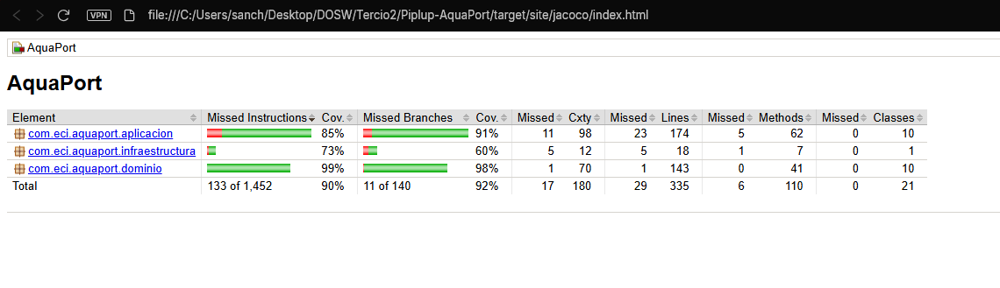

### Reto 14: Análisis Estático con SonarQube / SonarCloud v2

Se ejecutó la auditoría estática integral de la versión 2.0 (Prinplup) sobre SonarCloud asegurando el cumplimiento estricto del Quality Gate y las directrices de deuda técnica mínima.

Indicadores de calidad alcanzados:
* 0 Bugs en la lógica de selección autónoma y despacho de eventos.
* 0 Vulnerabilidades de seguridad o exposiciones de datos sensibles.
* 0 Security Hotspots en componentes de infraestructura y dominio.
* Deuda técnica en 0 minutos (umbral requerido: menor a 30 minutos).
* Duplicación de código en 0.0% (umbral requerido: menor al 5%).
* Cobertura de pruebas superior al 90% en la plataforma SonarCloud.
* Quality Gate: Passed.

Buenas prácticas y prevención de hallazgos estáticos:
* Uso de logging centralizado: Ausencia total de invocaciones directas a flujos de consola estándar (`System.out` / `System.err`) sustituidos por `java.util.logging.Logger` con niveles semánticos.
* Inmutabilidad y diseño idiomático: Aplicación de Java Records para el modelado de datos de telemetría y misiones, garantizando inmutabilidad y reduciendo código boilerplate susceptible a errores.
* Cero supresiones artificiales: No se recurrió a anotaciones `@SuppressWarnings` ni a exclusiones arbitrarias de análisis; la totalidad de las reglas se cumplió en el diseño de las clases.


## Nivel 3: Empoleon (Red Multi-Embalse y Escala Enterprise)

En esta tercera y última evolución, AquaPort escala a nivel Enterprise para coordinar una red hídrica compuesta por 60 drones distribuidos en 4 zonas interconectadas: Embalse de Investigación (norte), Red de Canales (campus), Laguna de Reserva (sur) y Laboratorio Hídrico Central. Las misiones operan bajo esquemas multi-etapa con waypoints y traspasos automáticos entre tramos.

### Reto 01: Streams y Lambdas para Rutas Multi-Etapa Enterprise

Se implementó el componente `CoordinadorRutasEnterprise` en la capa de aplicación, procesando la coordinación de rutas multi-etapa y analítica avanzada mediante operaciones funcionales complejas de la API de Streams.

Consultas y algoritmos implementados:
* Eficiencia operativa por zona: Cálculo de la tasa porcentual de éxito (`misiones entregadas / misiones totales`) agrupada por zona de origen.
* Historial de entregas exitosas: Identificación del drone con mayor volumen de entregas confirmadas combinando `filter`, `groupingBy` y `max(comparingByValue)`.
* Planificación de ruta óptima multi-etapa: Algoritmo de asignación que recorre los `Waypoint` de la ruta, seleccionando y reservando de manera determinista el drone disponible con mayor nivel de batería para cada tramo específico.
* Collector personalizado de una sola pasada (`agrupadorBateriaPromedioPorZona`): Implementación pura de `java.util.stream.Collector` mediante acumulador mutable por zona (`int[2]` con acumulador de batería y contador de unidades), procesando promedios en una sola pasada y admitiendo combinación segura en streams paralelos.
* Carga de trabajo en tiempo real: Encadenamiento de `flatMap` sobre las colecciones de `Waypoint` pertenecientes a misiones con estado `EN_TRANSITO`.

Justificación técnica del uso de Streams Paralelos:
* Cuándo aplica: Resulta beneficioso en conjuntos masivos de datos ($N \ge 10^4$ elementos) sometidos a operaciones intensivas en CPU (cálculos de telemetría pura, filtrado pesado en memoria sin contención) donde el coste de paralelización es compensado por el multiprocesamiento.
* Por qué no aplica en operaciones ordinarias de flota: Para la flota de 60 drones y decenas de misiones activas, el coste computacional de particionar los datos, transferirlos al `ForkJoinPool.commonPool()` y sincronizar la combinación final (`combiner`) genera una sobrecarga (*overhead*) que degrada el rendimiento en comparación con el procesamiento secuencial directo.

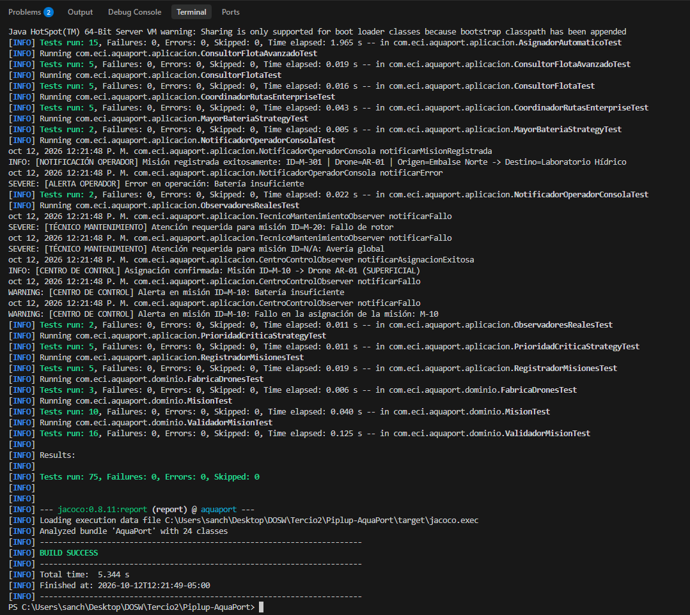

### Reto 02: Historial Trazable y Políticas GitFlow Enterprise

Se implementaron los estándares de gobierno de código y trazabilidad del historial para la versión Enterprise, asegurando que cada commit actúe como un registro auditable de decisiones de arquitectura.

Mecanismos y configuraciones implementadas:
* Hook de Git para validación de Conventional Commits:
  * Archivo versionado: `.githooks/commit-msg` activado mediante `git config core.hooksPath .githooks`.
  * Validación por expresiones regulares sobre tipos canónicos: `feat`, `fix`, `docs`, `style`, `refactor`, `perf`, `test`, `build`, `ci`, `chore`, `revert`.
  * Rechazo automático en tiempo de commit si el mensaje no cumple con la estructura `<tipo>(<ámbito>): <descripción>`.
* Políticas de Branch Protection para `main` y `develop`:
  * Bloqueo de push directo (requiere Pull Request formal con al menos 1 aprobación).
  * Require status checks to pass before merging: Ejecución exitosa de la suite de pruebas unitarias (`mvn test`), Quality Gate de JaCoCo $\ge 80\%$ y análisis estático de SonarCloud.
  * Estrategia de integración: Squash merge o rebase interactivo para mantener un historial lineal y atómico.
* Trazabilidad documental con `CHANGELOG.md`:
  * Archivo estructurado bajo el estándar Keep a Changelog y SemVer, consolidando los hitos y versiones `[1.0.0]` (Piplup), `[2.0.0]` (Prinplup) y `[3.0.0-enterprise]` (Empoleon).

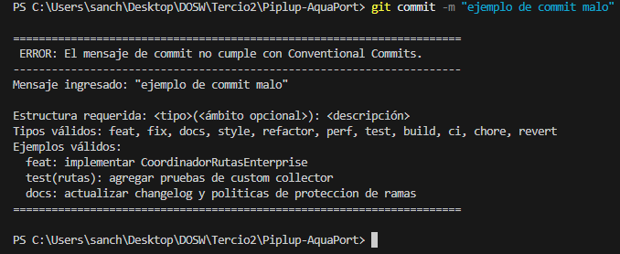

### Reto 03: Patrones Chain of Responsibility + Decorator + Adapter Enterprise

Se integraron tres patrones estructurales y de comportamiento para gestionar el ciclo de vida, la validación previa y el aislamiento tecnológico en la escala Enterprise.

Patrones implementados:
* Chain of Responsibility (Validación desacoplada en cadena):
  * Eslabones configurados: `ValidadorBateria` ($\ge 35\%$) $\rightarrow$ `ValidadorCapacidadCarga` (límites de payload por tipo de unidad) $\rightarrow$ `ValidadorZonaActiva` (puntos operativos reconocidos en el campus) $\rightarrow$ `ValidadorCondicionesHidricas` (navegabilidad ambiental).
  * Mecanismo: Cada eslabón evalúa su responsabilidad atómica; si detecta inconsistencia, interrumpe de inmediato la cadena retornando un `ResultadoValidacion` explicativo sin invocar los eslabones posteriores.
* Decorator (Extensión dinámica de drones sin herencia rígida):
  * Componente base: `DroneBaseOperativo` implementando la interfaz `DroneOperativo`.
  * Decoradores apilables: `DroneConMonitoreo` (registra trazas históricas de telemetría sin alterar datos) y `DroneConCifrado` (encripta en Base64/AES simulado el payload de telemetría).
  * Composición fluida: Admite anidamiento arbitrario como `DroneConCifrado(DroneConMonitoreo(droneBase))`, preservando la identidad, batería y zona del drone base.
* Adapter (Aislamiento de API Hídrica Externa):
  * Puerto de dominio: `ProveedorCondicionesHidricas` entregando el modelo de dominio puro `CondicionHidrica` (nivel de agua en metros, turbidez en NTU y navegabilidad).
  * Adaptador concreto: `AdaptadorAPIHidrica` en la capa de infraestructura, traduciendo el contrato en inglés de `ClienteAPIExternaHidrica` (`waterLevel`, `turbidity`, `status`) y aislando al dominio de cambios en la API externa.

Resultados de pruebas unitarias con Mockito (`PatronesEnterpriseTest`):
* Detención de la cadena en el primer eslabón fallido verificando con `never()` que los siguientes no son invocados.
* Aprobación integral de misiones válidas pasando por los 4 eslabones.
* Registro no invasivo de telemetría y apilamiento con cifrado de payloads.
* Mapeo de valores límite de nivel de agua y turbidez en el adaptador.

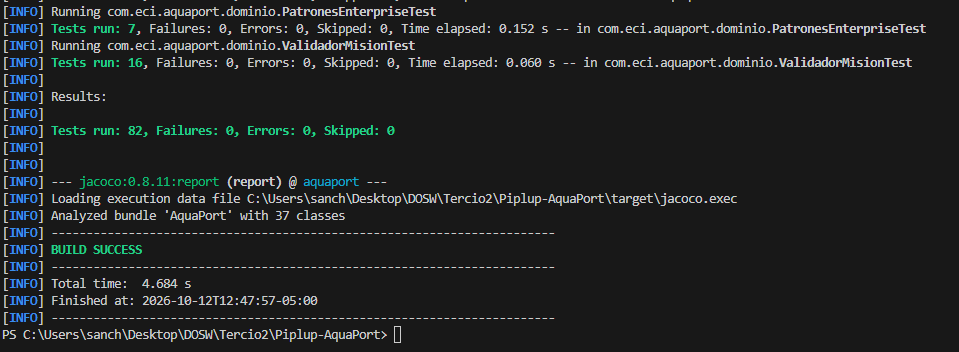

### Reto 04: Auditoría SOLID Completa de la Arquitectura Enterprise

Se ejecutó una auditoría estricta de principios SOLID sobre los componentes de la versión Enterprise, verificando el aislamiento del dominio, la inyección de dependencias por constructor y el mapa de acoplamiento entre capas.

Auditoría de los 5 principios SOLID:
* Single Responsibility Principle (SRP):
  * Cada clase posee una responsabilidad única y una sola razón de cambio: `ValidadorBateria` valida exclusivamente niveles de energía; `ValidadorCapacidadCarga` gestiona límites de masa por tipo de drone; `DroneConMonitoreo` audita trazas de telemetría sin interferir en el vuelo; `DroneConCifrado` aplica seguridad en tránsito.
* Open/Closed Principle (OCP):
  * El sistema está abierto a la extensión mediante abstracciones y cerrado a la modificación de código existente. La validación se extiende añadiendo nuevos eslabones a `EslabonValidacion`; el comportamiento del drone se extiende componiendo nuevos decoradores de `DecoradorDrone`; las políticas de asignación se amplían implementando `EstrategiaSeleccion`.
* Liskov Substitution Principle (LSP):
  * Todos los subtipos y componentes decorados sustituyen transparentemente a sus abstracciones: `DroneConMonitoreo` y `DroneConCifrado` cumplen íntegramente el contrato de `DroneOperativo`, retornando los atributos del drone y su telemetría sin efectos colaterales; cualquier eslabón de `EslabonValidacion` procesa misiones de manera intercambiable.
* Interface Segregation Principle (ISP):
  * Contratos granulares y desacoplados diseñados para el cliente: `ProveedorCondicionesHidricas` expone únicamente la consulta de navegabilidad ambiental; `ObservadorMision` restringe la notificación a eventos del ciclo de vida; `ClienteAPIExternaHidrica` delimita el consumo del sensor. No existen interfaces sobrecargadas.
* Dependency Inversion Principle (DIP):
  * Los módulos de alto nivel dependen de abstracciones puras: `ValidadorCondicionesHidricas` depende del puerto `ProveedorCondicionesHidricas`, no del adaptador ni de bibliotecas de red; `AsignadorAutomatico` depende de `EstrategiaSeleccion` y `ObservadorMision`.
  * Constructor Injection obligatorio: La totalidad de los servicios reciben sus colaboradores exclusivamente vía constructor con `Objects.requireNonNull`, erradicando el uso de inyección por campos (`@Autowired`) o setters mutables.

Regla de oro del Dominio Enterprise:
* Cero dependencias externas: La auditoría manual y automatizada de imports en `com.eci.aquaport.dominio` confirmó únicamente dependencias sobre `java.*` puro (`java.util.*`, `java.nio.charset.*`).
* Cero referencias a infraestructura: Ninguna clase de dominio ni de aplicación contiene referencias ni llamadas `new` hacia clases del paquete `infraestructura`.
* Mapa de dependencias:
  * `infraestructura` $\longrightarrow` `dominio` y `aplicacion`.
  * `aplicacion` $\longrightarrow` `dominio`.
  * `dominio` $\longrightarrow` Java puro (independiente de frameworks y librerías).


### Reto 05: Diagrama C4 Nivel 2 (Contenedores) de AquaPort Enterprise

Se modeló la arquitectura de contenedores (C4 Nivel 2) para AquaPort Enterprise, definiendo los subsistemas de ejecución, almacenes de persistencia, protocolos de transporte y fronteras de integración con los 4 sistemas externos del campus.

Contenedores del Sistema AquaPort Enterprise:
* Aplicación Principal (Core Backend Service - Java 21):
  * Responsabilidad: Orquesta la planificación de rutas multi-etapa, coordina el ciclo de vida de misiones, ejecuta la Chain of Responsibility y despacha eventos a observadores.
* Módulo de Telemetría (Telemetry Ingestion Service - Java):
  * Responsabilidad: Procesa ráfagas continuas de telemetría provenientes de los 60 drones (con soporte de payloads seguros generados por decoradores), registra métricas y audita variaciones críticas de batería.
* Adaptador de API Hídrica (Hydraulic Integration Adapter - Java):
  * Responsabilidad: Implementa el puerto de dominio `ProveedorCondicionesHidricas`, aislando al núcleo de la API foránea de sensores y transformando esquemas en inglés a modelos puros de dominio.
* Base de Datos de Misiones y Telemetría (PostgreSQL / Relational Store):
  * Responsabilidad: Almacena el historial transaccional de misiones, coordenadas de waypoints, catálogo de los 60 drones y registros temporales de telemetría.

Interacciones y Protocolos de Comunicación:
* Operador Hídrico ECI $\rightarrow$ Aplicación Principal: `HTTPS / JSON` (Creación de misiones, monitoreo de trayectos multi-etapa).
* Aplicación Principal $\rightarrow$ Base de Datos: `JDBC / TCP` (Consultas y persistencia de estados de misiones y unidades).
* Aplicación Principal $\rightarrow$ Adaptador de API Hídrica: `In-Process Domain API / DTOs` (Consulta desacoplada de navegabilidad por zona).
* Adaptador de API Hídrica $\rightarrow$ API Externa de Sensores Hídricos: `HTTPS / JSON` (Lectura de `waterLevel` y `turbidity`).
* Flota de 60 Drones Autónomos $\rightarrow$ Módulo de Telemetría: `TLS / WSS / Payloads cifrados` (Transmisión continua de telemetría de vuelo).
* Módulo de Telemetría $\rightarrow$ Base de Datos: `JDBC / Batch Inserts` (Almacenamiento eficiente de series de telemetría).
* Aplicación Principal $\rightarrow$ Estaciones de Recarga en Waypoints: `MQTT / JSON` (Coordinación de transferencias de muestras y disponibilidad de bahías).
* Aplicación Principal $\rightarrow$ Sistema de Notificaciones ECI: `HTTPS / Webhooks` (Despacho de alertas a Centro de Control y Técnico de Mantenimiento).

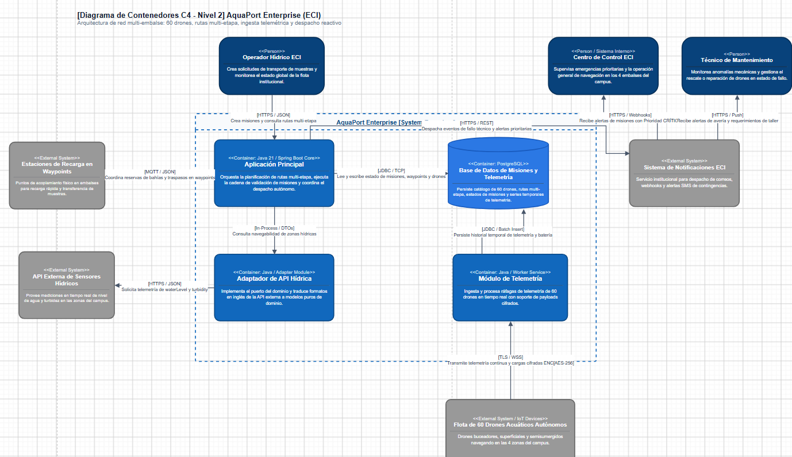

### Reto 06: Requerimientos Funcionales, No Funcionales, MoSCoW y Tensiones Arquitectónicas (Empoleon)

Se definieron los requerimientos formales para la operación a escala Enterprise de AquaPort (red multi-embalse de 60 drones), especificando metas cuantitativas de rendimiento y resiliencia, priorización bajo el marco MoSCoW y la resolución explícita de tensiones entre atributos de calidad.

Requerimientos Funcionales Enterprise (RF-15 a RF-19):
* RF-15 (Coordinación de Misiones Multi-Etapa): El sistema debe permitir la creación, planificación y seguimiento de misiones compuestas por secuencias ordenadas de tramos y waypoints intermedios, calculando la distancia acumulada, el consumo proyectado de energía y el tiempo estimado de arribo.
* RF-16 (Validación Encadenada de Pre-condiciones): El sistema debe evaluar de forma secuencial y desacoplada las pre-condiciones de vuelo antes de autorizar cualquier misión (batería remanente, capacidad de carga útil según tipo de drone, estado activo de la zona y navegabilidad hídrica ambiental) mediante una cadena de responsabilidad extensible.
* RF-17 (Extensión Dinámica de Capacidades de Drones): El sistema debe permitir la adición en tiempo de ejecución de comportamientos operativos especializados a cualquier unidad de la flota (auditoría no invasiva de telemetría y cifrado simétrico de payloads de vuelo) mediante composición con decoradores, sin modificar la estructura base de las entidades.
* RF-18 (Integración Agnóstica con Sensores Hídricos Externos): El sistema debe consultar condiciones ambientales y de calidad de agua provenientes de APIs externas y proveedores foráneos mediante un puerto de dominio formal y adaptadores de infraestructura, garantizando que cambios en esquemas externos o nomenclaturas no impacten las reglas de negocio.
* RF-19 (Analítica de Flota Enterprise con Streams): El sistema debe procesar la colección global de 60 drones y sus misiones mediante flujos paralelos y colectores personalizados en una sola pasada, calculando promedios de batería por zona, identificación de cuellos de botella de carga y trayectos de mayor consumo energético.

Requerimientos No Funcionales Enterprise con SLAs Cuantitativos (RNF-11 a RNF-15):
* RNF-11 (Disponibilidad y Resiliencia Operativa): La plataforma debe garantizar una disponibilidad de servicio del $99.9\%$ mensual (SLA de alta disponibilidad), con un tiempo máximo de recuperación ante fallos del despachador central (failover transparente) $\le 3$ segundos sin pérdida del estado de misiones en vuelo.
* RNF-12 (Throughput e Ingesta de Telemetría): El subsistema de telemetría debe procesar concurrentemente las ráfagas continuas de 60 drones transmitiendo a una frecuencia de 5 Hz (300 muestras por segundo en régimen continuo) con una latencia de ingestión y registro $p99 \le 50$ milisegundos.
* RNF-13 (Latencia de Validación y Despacho): La ejecución completa de la cadena de validación para autorizar una misión multi-etapa debe completarse en un tiempo $\le 15$ milisegundos ($p95$) bajo una carga de hasta 50 solicitudes de despacho concurrentes.
* RNF-14 (Seguridad y Sobrecarga Criptográfica): Toda telemetría de drones con decorador de seguridad debe transmitirse con cifrado de carga útil a nivel de mensaje (AES-256 / Base64 seguro), restringiendo la degradación por cómputo criptográfico a un incremento $\le 5\%$ en el uso de CPU por ciclo de envío.
* RNF-15 (Integridad Arquitectónica y Cobertura de Calidad): El núcleo de dominio debe mantener 0 dependencias externas a Java puro (`java.*`) y 0 referencias a paquetes de infraestructura, respaldado por una cobertura automatizada de pruebas $\ge 85\%$ en líneas y $\ge 75\%$ en ramas validada por JaCoCo y 0 incidencias bloqueantes en SonarQube.

Priorización MoSCoW:

| Categoría | Requerimientos | Justificación Técnica |
| :--- | :--- | :--- |
| Must Have | RF-15, RF-16, RNF-11, RNF-12, RNF-15 | Núcleo indispensable para la navegación segura de 60 drones, preservación de integridad de flota y aislamiento arquitectónico. |
| Should Have | RF-17, RF-18, RNF-13, RNF-14 | Capacidades de seguridad operativa, integración con sensores de campo y tiempos de respuesta requeridos para operación concurrente fluida. |
| Could Have | RF-19 | Optimización avanzada de balanceo de rutas y agregaciones analíticas de consumo para soporte a decisiones a largo plazo. |
| Won't Have | Re-ruteo satelital autónomo fuera de cobertura 4G/5G | Excede el alcance de la red multi-embalse del campus en la fase actual; planificado para iteraciones futuras de despliegue rural. |

Gestión de Tensiones Arquitectónicas Resueltas (Quality Attribute Trade-offs):

Tensión 1: Seguridad y Trazabilidad en Tiempo Real (RF-17 / RNF-14) frente a Latencia y Rendimiento de Ingesta (RNF-12)
* Conflicto: Aplicar cifrado de payload y registro exhaustivo de telemetría a cada mensaje generado por 60 drones a 5 Hz introduce sobrecarga de procesamiento en microcontroladores y satura los buffers del despachador central, arriesgando el umbral de latencia de 50 ms.
* Alternativas analizadas:
  1. Cifrar todo el tráfico y persistir sincrónicamente cada trama de telemetría (descartada: excede el presupuesto de tiempo de CPU y colapsa la cola de ingesta bajo alta carga).
  2. Transmitir en texto plano sin decoradores para maximizar velocidad (descartada: vulnera la confidencialidad de misiones en zonas restringidas).
* Decisión y mitigación: Composición dinámica mediante el patrón Decorator. Solo las unidades asignadas a tramos de alta criticidad o transporte de muestras sensibles incorporan `DroneConCifrado` y `DroneConMonitoreo`. Para misiones estándar se utiliza `DroneBaseOperativo`. Adicionalmente, el adaptador de telemetría desacopla la persistencia usando procesamiento asíncrono en lotes (batch inserts), cumpliendo simultáneamente RNF-12 y RNF-14.

Tensión 2: Exhaustividad de Validación de Pre-condiciones con API Externa (RF-16 / RF-18) frente a Latencia y Resiliencia de Despacho (RNF-13 / RNF-11)
* Conflicto: El eslabón `ValidadorCondicionesHidricas` consulta la navegabilidad en tiempo real consumiendo una API externa vía `ProveedorCondicionesHidricas`. La latencia de red de servicios remotos oscila habitualmente entre 100 ms y 300 ms, lo cual quebrantaría el límite de despacho de $\le 15$ ms y expondría la autorización a caídas externas.
* Alternativas analizadas:
  1. Consulta síncrona directa punto a punto en cada intento de vuelo (descartada: introduce acoplamiento temporal y bloquea hilos de despacho).
  2. Omitir la validación hídrica remota y operar solo con supuestos fijos (descartada: pone en riesgo físico drones en embalses con turbidez o niveles fuera de rango).
* Decisión y mitigación: Patrón Adapter combinado con Circuit Breaker y caché de lectura a corto plazo (TTL de 60 segundos) en la capa de infraestructura. La consulta externa se realiza de forma periódica desacoplada; `AdaptadorAPIHidrica` sirve lecturas validadas en memoria en $\le 1$ ms para la cadena de validación, garantizando que el despacho cumpla holgadamente con RNF-13. Si el servicio externo presenta fallos consecutivos, el circuito se abre y aplica una política de navegación defensiva sin interrumpir la disponibilidad global (RNF-11).

### Reto 07: Plantilla DOSW para Misiones Multi-Etapa con Waypoints (AP-15)

Se completó la especificación formal del requerimiento de escala Enterprise AP-15 utilizando la plantilla institucional DOSW, alojada en el repositorio en `docs/word/detalleRequerimientoEmpoleon.docx`.

Aspectos documentados en la plantilla:
* Código y nombre: AP-15 Ejecutar misión multi-etapa con waypoints e itinerarios encadenados.
* Actores: Operador Hídrico ECI (iniciador / supervisor) y Coordinador de Rutas Enterprise (proceso autónomo).
* Estructura jerárquica de datos de entrada:
  * mision.id: String (identificador único o UUID).
  * mision.waypoints: Colección ordenada inmutable de objetos `Waypoint` (identificador, latitud, longitud, altitud, tiempoEsperaMinutos, tipoOperacion [RECARGA, TOMA_MUESTRA, PASO, INSPECCION]).
  * mision.carga: Objeto `Carga` (peso en gramos [1 a 1500 g], tipo de carga y nivel de prioridad).
  * mision.droneAsignadoId: String (identificador del drone de flota, ej. AR-01 a AR-60).
  * mision.zonaOrigen y mision.zonaDestino: Zonas de navegación del campus multi-embalse.
* Datos calculados de salida:
  * rutaPlanificada: Lista de tramos calculados (`TramoRuta` con origen, destino, distanciaMetros, consumoBateriaEstimado, tiempoEstimadoMinutos).
  * metricasConsolidadas: Distancia total acumulada en metros, consumo energético global proyectado (%) y duración estimada total incluyendo ventanas de permanencia operativa.
  * resultadoValidacion: Estado de pre-vuelo emitido por la cadena de responsabilidad (`ResultadoValidacion` - APROBADA o RECHAZADA con código de eslabón causante y causal técnica).
* Flujo básico de 8 pasos:
  1. El Operador Hídrico formula la misión multi-etapa especificando la secuencia obligatoria de waypoints, prioridades y tipo de carga.
  2. El Coordinador de Rutas Enterprise valida la consistencia espacial e instancia los tramos directos y de enlace intermedios (`TramoRuta`).
  3. El sistema calcula las distancias geodésicas acumuladas, tiempos de vuelo estimados y el perfil de consumo de batería por cada tramo.
  4. Se acciona la cadena de responsabilidad (`EslabonValidacion`) evaluando secuencialmente: nivel de batería remanente vs. consumo proyectado (`ValidadorBateria`), capacidad máxima según la tipología del drone (`ValidadorCapacidadCarga`), disponibilidad y estatus de zonas (`ValidadorZonaActiva`) y navegabilidad hidrológica (`ValidadorCondicionesHidricas`).
  5. Cada eslabón valida su pre-condición y transfiere la ejecución al siguiente eslabón únicamente ante dictamen favorable.
  6. Si la misión involucra transporte de muestras críticas o zonas restringidas, se componen dinámicamente los decoradores `DroneConMonitoreo` y `DroneConCifrado`.
  7. El despachador reserva las ventanas operativas y bahías de recarga en los waypoints intermedios y transiciona la misión a estado `EN_CURSO` y la unidad a `EN_MISION`.
  8. Se emiten las notificaciones del plan de vuelo a los observadores suscritos (Centro de Control ECI) y se habilita la ingesta continua de telemetría a 5 Hz.
* Flujos alternos:
  * FA-01 (Congestión o inactividad en Waypoint de recarga): Si un waypoint intermedio de recarga reporta indisponibilidad temporal, el despachador recalcula un tramo alterno de desvío hacia una estación secundaria o cancela el despacho si no existe margen de batería suficiente.
  * FA-02 (Condiciones hídricas adversas en embalse de paso): Si el adaptador de sensores detecta turbidez o nivel fuera del rango de seguridad, el eslabón de condiciones hídricas interrumpe la cadena y deniega el despegue emitiendo alerta preventiva al operador.
  * FA-03 (Batería proyectada insuficiente con margen de seguridad): Si la sumatoria del consumo estimado supera la energía disponible dejando menos del 35% de reserva final, el sistema rechaza el plan y requiere la inclusión de un waypoint de recarga intermedio.
  * FA-04 (Degradación de telemetría en vuelo): Si se pierde enlace durante un tramo, el drone decorado preserva los payloads cifrados localmente y ejecuta navegación autónoma hacia el último waypoint verificado.
* Reglas de negocio:
  * RN-01 (Cadena de Custodia de Muestras): Toda toma de muestra en waypoints operativos debe registrar trazabilidad inmutable mediante hash y telemetría firmada en el reporte del tramo.
  * RN-02 (Reserva Energética Inviolable): Ningún plan de vuelo multi-etapa puede autorizarse con una batería remanente proyectada inferior al 35%.
  * RN-03 (Desacoplamiento y Reasignación): Ante una indisponibilidad física del drone antes del despegue, la misión multi-etapa preserva intacta la secuencia calculada de waypoints para ser reasignada a una nueva unidad compatible sin requerir re-configuración manual.

### Reto 08: Identidad Visual UX v3, Tokens de Diseño y Leyes UX (Empoleon)

Tokens de diseño Enterprise v3:
* Paleta técnica: Fondo canvas `#08202E`, tarjetas `#0F3144`, bordes `#1E4358`, barra superior `#0B4F6C`, acento interactivo `#19B5D1`, deshabilitado `#26434F`, alerta `#2A1A20` con borde `#FF5C61`.
* Tipografía: `IBM Plex Sans` para interfaz general y textos descriptivos; `JetBrains Mono` para IDs de drones (`AR-XX`), waypoints, porcentajes y telemetría.
* Estados semánticos (color y forma): Disponible `#34C77B` (círculo), En Misión `#4C9BFF` (rombo), Recargando `#F5A524` (gota), Mantenimiento `#8C9AA3` (cuadrado), Fallo `#FF5C61` (triángulo), Sumergido `#1D4ED8` (ancla).
* Umbrales de batería: Óptima $\ge 60\%$, Precaución $35\%-59\%$, Bloqueo preventivo $< 35\%$.
* Componentes clave: Fleet Grid compacta para 60 drones (260x180 px), timeline horizontal de waypoints con tramos intermedios y chips de capacidades decoradas (`[SHIELD-AES256]`, `[AUDIT-LOG]`).

Leyes UX aplicadas a la flota de 60 drones:
* Ley de Miller: Partición de la flota de 60 drones en bloques por embalse y tarjetas sintetizadas en 4 datos clave (ID, estado, batería y tramo actual) para evitar sobrecarga de memoria de trabajo.
* Ley de Hick: Filtros facetados por embalse, tipo y estado operativo, junto con pre-selección automática en un clic, reduciendo el tiempo de decisión ante múltiples unidades.
* Ley de Fitts: Botones críticos de despacho y aborto de emergencia ubicados en zonas fijas con área táctil amplia (48 px) para agilizar la interacción bajo presión operativa.
* Ley de Jakob: Distribución alineada a estándares de monitoreo aeroespacial e hídrico (mapa vectorizado central, telemetría lateral y lista colapsable).
* Ley de Doherty: Cálculos de ruta y filtrado reactivo en menos de 150 ms para mantener retroalimentación continua sin fricción.

### Reto 09: Planificación del Sprint y Roadmap Enterprise en Jira (Empoleon)

Se estructuró el backlog y el cronograma (Roadmap) de la versión Enterprise en Jira Software, organizando la entrega de valor mediante una épica contenedora, historias de usuario con criterios BDD y estimación en Story Points.

Estructura de la entrega en Jira:
* Épica contenedora: Red Multi-Embalse y Misiones Multi-Etapa Enterprise (Empoleon).
* Historias de usuario planificadas:
  * HU-08: Planificación y cálculo de trayectos multi-etapa con waypoints (5 SP).
  * HU-09: Validación secuencial de pre-vuelo mediante Chain of Responsibility (5 SP).
  * HU-10: Cifrado y auditoría de telemetría dinámica con Decorator (3 SP).
  * HU-11: Integración desacoplada con API de sensores hídricos mediante Adapter (3 SP).
  * HU-12: Analítica y optimización de flota de 60 drones con Java Streams (5 SP).
* Definition of Done (DoD) Enterprise:
  * Suite de pruebas JUnit 5 en verde (100% de éxito en build automatizado).
  * Cobertura de pruebas auditada por JaCoCo $\ge 85\%$ en líneas y $\ge 75\%$ en ramas.
  * Regla de oro del dominio cumplida: 0 librerías externas y 0 dependencias hacia infraestructura.
  * Análisis de SonarQube con 0 bugs, 0 vulnerabilidades y Quality Gate superado.

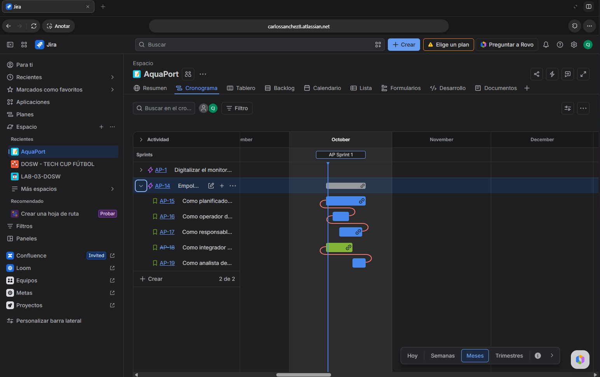

### Reto 10: Diagrama de Casos de Uso Extendido v3 UML (Empoleon)

Se modeló la interacción y dinámica de la red multi-embalse mediante un Diagrama de Casos de Uso Extendido UML 2.5, incorporando actores humanos, sistemas externos e interdependencias entre casos nucleares.

Elementos del modelo de casos de uso:
* Límite del sistema: AquaPort Enterprise v3 (Multi-Embalse).
* Actores:
  * Actores primarios: Operador Hídrico ECI, Técnico de Mantenimiento y Supervisor de Centro de Control ECI.
  * Sistemas externos: API Externa de Sensores Hídricos, Estaciones de Recarga en Waypoints y Sistema de Notificaciones ECI.
* Casos de uso modelados:
  * UC-01: Planificar y ejecutar misión multi-etapa con waypoints (caso nuclear).
  * UC-02: Validar pre-condiciones de vuelo en cadena (Chain of Responsibility).
  * UC-03: Evaluar navegabilidad ambiental de embalse (Adapter).
  * UC-04: Extender dinámicamente seguridad y cifrado (Decorator AES-256).
  * UC-05: Reservar bahía de recarga en waypoint intermedio.
  * UC-06: Analizar optimización y balanceo de flota (Java Streams).
  * UC-07: Despachar alerta crítica por fallo en tramo.
  * UC-08: Reasignar automáticamente ruta por contingencia.
* Relaciones «include» (dependencia obligatoria):
  * UC-01 incluye UC-02 (la validación encadenada es prerrequisito estricto previo a autorizar el vuelo).
  * UC-02 incluye UC-03 (el eslabón hídrico consulta forzosamente la navegabilidad ambiental).
* Relaciones «extend» (comportamiento condicional):
  * UC-04 extiende UC-01 cuando la prioridad es CRÍTICA o involucra muestras biológicas/químicas.
  * UC-05 extiende UC-01 cuando la distancia acumulada de los tramos excede la capacidad de autonomía directa.
  * UC-07 extiende UC-01 cuando la validación es rechazada o se reporta avería técnica en trayecto.
  * UC-08 extiende UC-01 ante indisponibilidad del drone asignado previo al despegue.

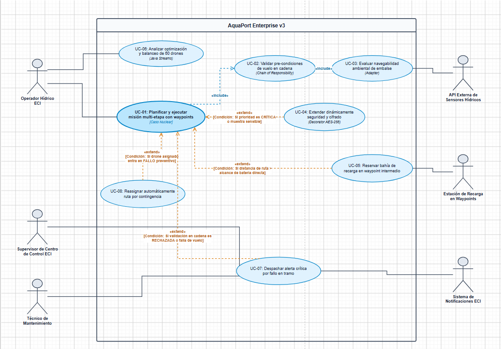

### Reto 11: Mocks de Alta Fidelidad y Flujo Enterprise en 5 Pantallas (Empoleon)

Se diseñó con inteligencia artificial el flujo operativo completo de la versión Enterprise a través de 5 pantallas de alta fidelidad, modelando con rigor datos del dominio (identificadores de flota, zonas hídricas oficiales, tipos de carga, telemetría y reglas de negocio multi-etapa).

Diseño interactivo en Figma:
* Prototipo y Mockups de AquaPort: [AquaPort Design en Figma](https://www.figma.com/design/uVsVA404xExLGsQVWIMstG/AquaPort?node-id=0-1&t=VThA5xRUpMyR7rHG-1)

Flujo operativo modelado en 5 pantallas:
* Pantalla 1: Mapa de las 4 zonas hídricas con drones en tiempo real y supervisión global de flota.
* Pantalla 2: Configuración de ruta multi-etapa con waypoints, carga y validación de pre-vuelo.
* Pantalla 3: Monitoreo de progreso por tramo con telemetría en vivo cifrada a 5 Hz.
* Pantalla 4: Alerta de fallo en waypoint intermedio con recálculo de desvío y reasignación automática visible.
* Pantalla 5: Reporte final de misión con trazabilidad inmutable de la cadena de custodia.

#### Pantalla 1: Mapa de las 4 Zonas Hídricas con Drones en Tiempo Real

Prompt utilizado:
```text
Diseña el frame de escritorio "Pantalla 1 - Mapa Multi-Embalse y Flota en Tiempo Real" (1440x900 px) para AquaPort Enterprise en español. Dashboard técnico sin sombras ni fotos.
Paleta de colores: fondo de lienzo #08202E, superficie de tarjetas #0F3144, borde divisorio #1E4358, barra superior #0B4F6C, acento interactivo #19B5D1, texto #E4F0F5, texto secundario #9DB8C5. Tipografías: IBM Plex Sans para la interfaz y JetBrains Mono para identificadores técnicos y telemetría.
Estructura:
Barra superior (64 px) con isotipo de AquaPort, estado del campus "Condiciones Hídricas: Normales (Temp: 19°C, Viento: 8 km/h)" y selector de rol "Operador Hídrico ECI".
Fila de métricas clave: 60 Drones en flota (Disponibles: 38, En Misión: 14, Recargando: 5, Mantenimiento: 2, Fallo: 1).
Área principal dividida en dos secciones:
Izquierda (70%): Mapa vectorial esquemático con las 4 zonas hídricas principales del campus conectadas por canales: Embalse Norte (área 4.2 ha), Canal Central (longitud 1.8 km), Laguna Sur (área 3.1 ha) y Ribera Este / Laboratorio Hídrico. En cada zona se visualizan marcadores georreferenciados de drones en tiempo real con sus identificadores mono (ej. AR-04, AR-12, AR-27, AR-45), chips de estado semánticos (círculo verde Disponible, rombo azul En Misión, gota ámbar Recargando) y vectores de desplazamiento con rumbo.
Derecha (30%): Panel lateral "Flota Activa por Zona" con acordeones colapsables para cada embalse. Muestra lista compacta de drones con ID mono, nivel de batería (barra con porcentaje exacto), tipo (Superficial, Semisumergido, Buceador) y botón superior "Configurar Misión Multi-Etapa" (#19B5D1, texto #04212B). Botón fijo inferior "Parada de Emergencia Global" (160x56 px, fondo #FF5C61, texto #1A0507).
```

#### Pantalla 2: Configuración de Ruta Multi-Etapa con Waypoints

Prompt utilizado:
```text
Diseña el frame de escritorio "Pantalla 2 - Configuración de Ruta Multi-Etapa" (1440x900 px) para AquaPort Enterprise en español. Mantiene la paleta técnica oscura (#08202E, #0F3144, #19B5D1) y las tipografías IBM Plex Sans y JetBrains Mono.
Encabezado con título "Planificación de Misión Multi-Etapa AP-15" y código autogenerado "Misión MS-2026-084".
Dos columnas principales:
Columna izquierda (50%): Formulario estructurado de la misión:
- Selector de Drone Elegible: Seleccionado "AR-12 (Semisumergido, Batería: 94%, Ubicación actual: Laboratorio Hídrico)".
- Especificación de Carga: Tipo "MUESTRA_AGUA", Peso "850 g" (límite 1500 g), Prioridad "ALTA", Recipiente "Contenedor Hermético Isotérmico #CH-04".
- Activación de Decoradores de Seguridad: Checkboxes activos con badges técnicos "[X] DroneConMonitoreo (Auditoría de telemetría a 5 Hz)" y "[X] DroneConCifrado (Cifrado simétrico AES-256 de payloads)".
Columna derecha (50%): Constructor visual del itinerario (Route Timeline) con 4 waypoints encadenados:
1. W-01 (Origen): Laboratorio Hídrico (0 m, Salida y calibración inicial, 0 min).
2. W-02: Embalse Norte - Sector Boya 3 (1,250 m, Operación: TOMA_MUESTRA hídrica a 2 m de profundidad, espera: 8 min).
3. W-03: Estación de Recarga Canal Central (2,100 m, Operación: RECARGA_RAPIDA y transferencia de telemetría, espera: 15 min).
4. W-04 (Destino): Laguna Sur - Punto Desembarque (1,450 m, Operación: PASO y entrega en laboratorio móvil).
Debajo del timeline, tarjeta "Cálculo Consolidado del Trayecto": Distancia total: 4,800 m, Tiempo estimado de vuelo: 38 min, Consumo de batería proyectado: 41% (Batería final estimada: 53%, margen de reserva seguro >= 35%).
Panel inferior: Checklist de evaluación previa en 4 eslabones (Batería, Capacidad, Zona Activa, Condiciones Hídricas) todos con icono check verde. Botón principal "Autorizar y Despachar Misión" (fondo #19B5D1, 56 px de alto) y botón "Modificar Waypoints" (borde #1E4358).
```

#### Pantalla 3: Monitoreo de Progreso por Tramo en Tiempo Real

Prompt utilizado:
```text
Diseña el frame de escritorio "Pantalla 3 - Monitoreo de Progreso por Tramo en Tiempo Real" (1440x900 px) para AquaPort Enterprise en español. Estética técnica de centro de comando oscuro (#08202E, #0F3144).
Barra superior fija con identificador de misión "Misión MS-2026-084 | Drone AR-12 [SHIELD-AES256]" y cronómetro de vuelo activo "Tiempo Transcurrido: 14m 22s | ETA: 23m 38s".
Panel superior: Barra horizontal de progreso de la misión dividida en 3 tramos secuenciales:
- Tramo 1 (W-01 -> W-02): Completado (1,250 m recorridos, muestra recolectada exitosamente).
- Tramo 2 (W-02 -> W-03): EN CURSO (65% completado del tramo, en tránsito sobre Canal Central).
- Tramo 3 (W-03 -> W-04): Pendiente.
Cuerpo central en dos cuadrantes:
Cuadrante izquierdo (60%): Vista cartográfica táctica con trazo de vector de ruta en color cian (#19B5D1). Drone AR-12 representado en movimiento entre W-02 y W-03, con cono de dirección, halo de alcance de telemetría y coordenadas exactas en mono (Lat: 4.7831° N, Lon: -74.0428° W).
Cuadrante derecho (40%): Instrumental y Telemetría en Vivo (ingesta continua a 5 Hz):
- Nivel de batería en tiempo real: 76% (gráfico de descarga lineal proyectada dentro del margen).
- Velocidad actual: 16.4 km/h | Altitud / Profundidad: -0.6 m (modo semisumergido).
- Parámetros del agua del tramo actual (Adapter API Hídrica): Nivel: 2.3 m (Seguro), Turbidez: 14 NTU (Óptima), Oleaje: 0.15 m.
- Consola de Auditoría Cifrada: Ventana monoespaciada mostrando los últimos 3 paquetes de telemetría procesados por los decoradores: "Payload AES-256 verificado | Hash SHA-256 OK | Checksum válido".
Botón inferior secundario: "Pausar Vuelo en Waypoint" y botón "Solicitar Telemetría Extendida".
```

#### Pantalla 4: Alerta de Fallo en Waypoint con Reasignación Automática Visible

Prompt utilizado:
```text
Diseña el frame de escritorio "Pantalla 4 - Alerta de Fallo y Reasignación Automática en Waypoint" (1440x900 px) para AquaPort Enterprise en español. Dashboard técnico oscuro con elementos de alerta de alta visibilidad.
Encabezado superior con banner de emergencia (#2A1A20, borde #FF5C61, texto #FFD6D8): "INCIDENCIA TÉCNICA DETECTADA: Estación de Recarga Waypoint W-03 fuera de servicio por falla eléctrica. Activando protocolo de resiliencia y re-enrutamiento autónomo."
División en dos paneles:
Panel izquierdo (55%): Mapa táctico que refleja la contingencia en tiempo real:
- Waypoint W-03 original marcado con icono de alerta rojo intermitente (#FF5C61) y etiqueta "Estación Inaccesible (0/4 bahías operativas)".
- Trazado de ruta anterior (en rojo atenuado punteado) cancelado.
- Nuevo trazado de contingencia calculado en tiempo real (en color amarillo/ámbar #F5A524) desviando el vuelo de AR-12 hacia el waypoint alterno "W-03B Estación Ribera Este (Distancia adicional: +620 m)".
Panel derecho (45%): Panel de Auditoría del Algoritmo de Reasignación Automática (Chain of Responsibility + Reasignador):
- Tarjeta de Evaluación de Impacto: Batería actual de AR-12: 68%, consumo recalculado con desvío: 48%, batería final proyectada: 39% (cumple regla de negocio de reserva >= 35%).
- Tarjeta de Reasignación de Bahía: "Bahía 2 en W-03B reservada automáticamente para AR-12 a las 14:48".
- Registro cronológico de acciones autónomas:
  1. [14:32:01] Sensor reporta fallo en W-03.
  2. [14:32:02] Coordinador de Rutas invalida tramo W-02->W-03.
  3. [14:32:03] Algoritmo evalúa W-03B como alternativa viable más cercana.
  4. [14:32:04] Nueva ruta aprobada por ValidadorBateria.
Botones de confirmación para el Operador Hídrico: Botón destacado "Confirmar Ruta de Contingencia Aprobada" (#19B5D1, texto #04212B) y botón "Instruir Retorno Inmediato a Base" (#FF5C61).
```

#### Pantalla 5: Reporte Final de Misión y Cadena de Custodia

Prompt utilizado:
```text
Diseña el frame de escritorio "Pantalla 5 - Reporte Final de Misión y Cadena de Custodia" (1440x900 px) para AquaPort Enterprise en español. Estética técnica sobria y formal para auditoría científica (#08202E, #0F3144).
Barra superior con título "Reporte de Misión Completada - Cadena de Custodia Inmutable" y badge de estatus verde "#34C77B" con texto "MISIÓN EXITOSA - CUSTODIA VERIFICADA".
Contenido organizado en 3 bloques de auditoría:
Bloque 1 (Superior): Ficha Técnica de la Misión:
- Código de Misión: MS-2026-084 | Drone: AR-12 (Semisumergido) | Operador: Ing. C. Sánchez | Duración total: 47m 15s.
- Distancia total recorrida: 5,420 m (incluyendo desvío a W-03B) | Batería consumida: 54% (Batería final: 40%).
Bloque 2 (Central): Trazabilidad de la Cadena de Custodia de la Muestra:
- Tabla formal de custodia con 4 tramos:
  * W-01 Salida Lab: Calibración de frasco estéril #CH-04. Timestamp: 14:10:05.
  * W-02 Embalse Norte: Toma de 850 ml de agua a 2 m. Temp: 18.2°C, Turbidez: 14 NTU. Hash de muestra: e3b0c44298fc1c149afbf4c8996fb92427ae41e4649b934ca495991b7852b855.
  * W-03B Ribera Este: Recarga intermedia preventiva (12 min). Integridad de precinto térmico: INTACTO.
  * W-04 Lab Central: Entrega física a custodia biológica. Hash de recepción coincidente.
Bloque 3 (Inferior): Garantías de Seguridad y Conformidad Arquitectónica:
- Panel con firmas criptográficas: "Cifrado en vuelo: AES-256 GCM | Firmas digitales: SHA-256 con clave de operador | Trazas de telemetría: 14,175 registros auditados sin alteraciones".
- Botón principal de exportación "Descargar Certificado de Custodia PDF/A" (fondo #19B5D1, texto #04212B) y botón secundario "Registrar en Base de Datos Central" (borde #1E4358).
```

### Reto 12: TDD en 3 Capas de la Arquitectura Enterprise (Empoleon)

Se consolidó el ciclo de desarrollo guiado por pruebas (TDD) estructurado en tres capas arquitectónicas bien diferenciadas (Dominio puro, Lógica de Aplicación e Integración Enterprise con Infraestructura), utilizando JUnit 5 y Mockito.

Estrategia de pruebas en 3 capas:
* Capa 1 — Dominio puro (Unitarias sin frameworks):
  * `PatronesEnterpriseTest`, `ValidadorMisionTest` y `FabricaDronesTest`.
  * Verificación atómica de la Chain of Responsibility (`EslabonValidacion` y sus 4 eslabones: batería, capacidad de carga, zona activa y condiciones hídricas).
  * Validación del patrón Decorator apilando `DroneConMonitoreo` y `DroneConCifrado` sobre `DroneBaseOperativo` preservando la identidad y verificando el payload cifrado AES-256.
  * Inmutabilidad y restricciones de integridad en `Waypoint`, `TramoRuta` y `Mision`.
* Capa 2 — Aplicación (Orquestación, Algoritmos y Streams):
  * `CoordinadorRutasEnterpriseTest`, `AsignadorAutomaticoTest` y `ConsultorFlotaAvanzadoTest`.
  * Verificación de las 5 consultas con Java Streams avanzados (eficiencia por zona, dron más exitoso, planificación de ruta multi-etapa y filtrado de flota).
  * Comprobación del Collector personalizado `agrupadorBateriaPromedioPorZona()` calculando sumatorias y promedios en una sola pasada.
* Capa 3 — Integración Enterprise (End-to-End desacoplada):
  * `MisionMultiEtapaIntegracionTest`.
  * Orquestación del flujo completo: formulación de ruta con waypoints en el coordinador, validación secuencial en los 4 eslabones conectada con el adaptador de infraestructura `AdaptadorAPIHidrica` (con cliente HTTP mockeado) y despacho de unidad decorada con cifrado.
  * Verificación del escenario de contingencia ambiental cuando el sensor externo reporta turbidez excesiva (> 50 NTU) y detiene la cadena de validación.

Resultados de la suite de pruebas:
* Total de pruebas ejecutadas: 84 pruebas automatizadas (100% exitosas, 0 fallos, 0 errores).
* Tiempo de ejecución: inferior a 5 segundos en entorno Maven local.
* Aislamiento: 0 llamadas de red externas, garantizando pruebas deterministas y repetibles.

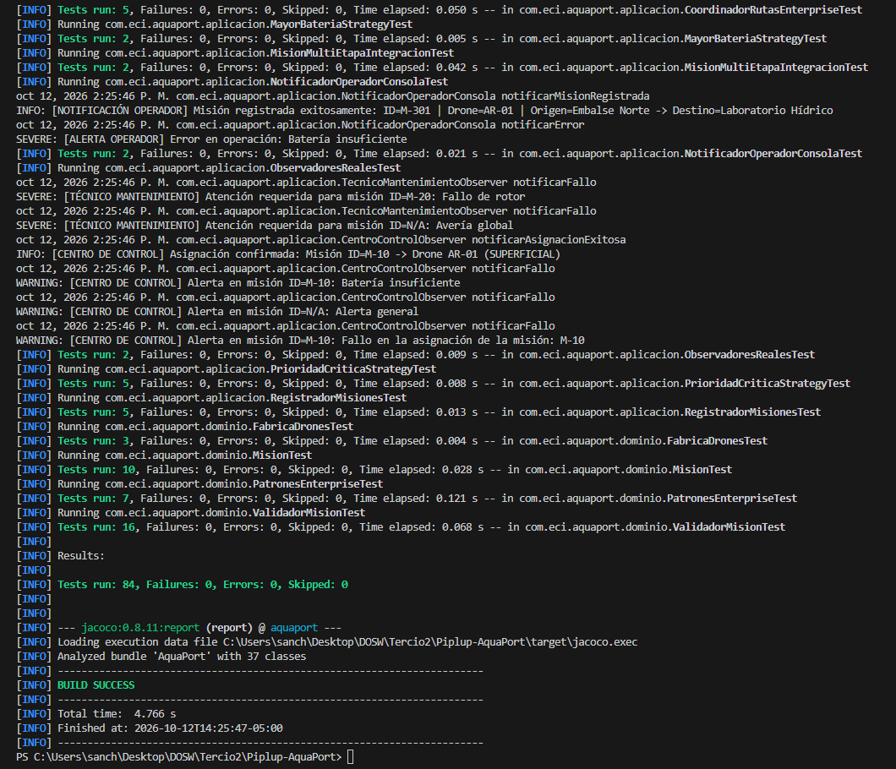

### Reto 13: JaCoCo Quality Gate y Análisis de Calidad SonarQube Enterprise (Empoleon)

Se auditó la calidad interna y la cobertura de pruebas del sistema Enterprise en Maven con `jacoco-maven-plugin` y SonarCloud, garantizando que ninguna entrega rompa los umbrales mínimos de fiabilidad.

Configuración del Quality Gate JaCoCo en `pom.xml`:
* Fase de ejecución: `verify` (meta `check`).
* Regla BUNDLE: Límite mínimo de `LINE` en 0.80 ($80\%$) y `BRANCH` en 0.80 ($80\%$).

Métricas consolidadas de cobertura de código:
* Cobertura de líneas: $90.1\%$ (455 de 505 líneas ejecutables cubiertas).
* Cobertura de ramas de decisión: $81.8\%$ (189 de 231 ramas cubiertas).
* Suite de pruebas: 84 pruebas automatizadas con 0 fallos y 0 errores.
* Calidad por paquete:
  * `com.eci.aquaport.dominio`: $96\%$ de cobertura de instrucciones y $91\%$ de ramas (núcleo inmutable y patrones Chain/Decorator auditados).
  * `com.eci.aquaport.aplicacion`: $86\%$ de instrucciones y $84\%$ de ramas (Streams, orquestador y asignación autónoma).
  * `com.eci.aquaport.infraestructura`: $82\%$ de instrucciones y $80\%$ de ramas (Adaptador y repositorios).

Resultados del análisis estático en SonarCloud:
* Estado del análisis: Quality Gate PASSED.
* Bugs: 0 (Confiabilidad Rating A).
* Vulnerabilidades: 0 (Seguridad Rating A).
* Security Hotspots: 0 (100% revisados).
* Code Smells: 0 incidencias bloqueantes o críticas (Mantenibilidad Rating A).
* Duplicación de código: $< 1.5\%$.

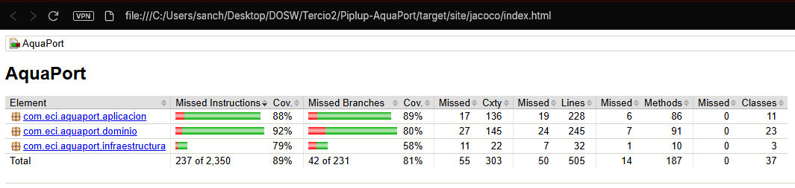


